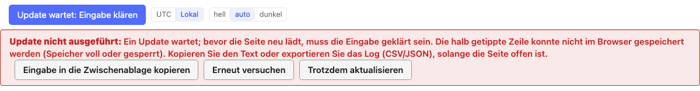
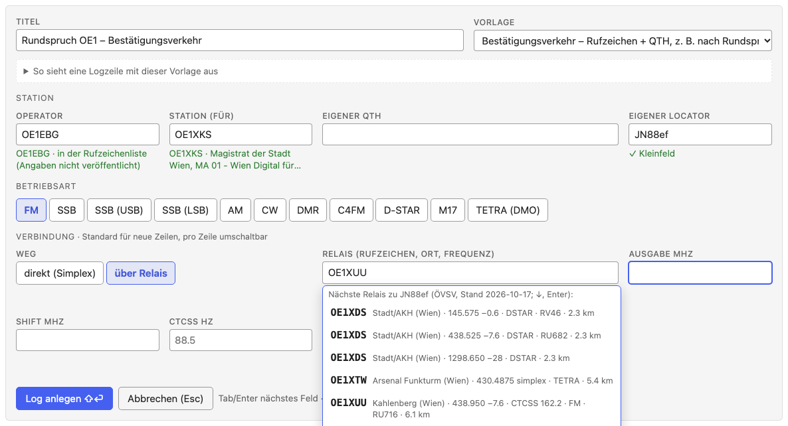
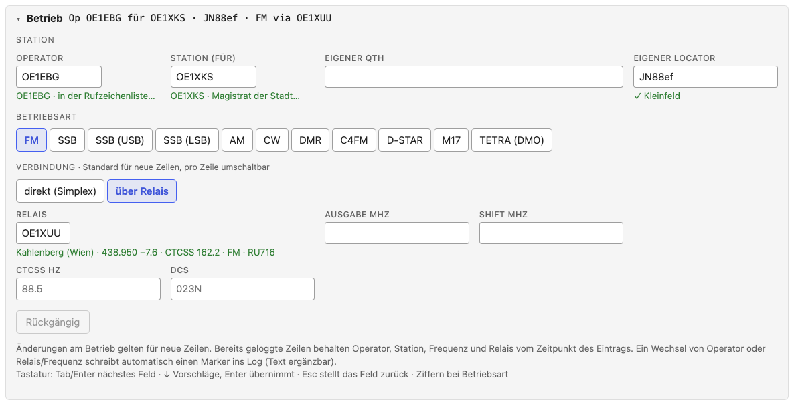
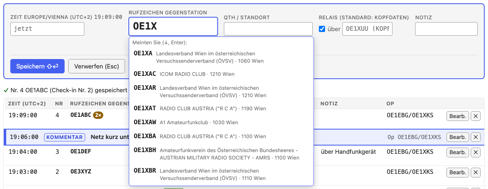
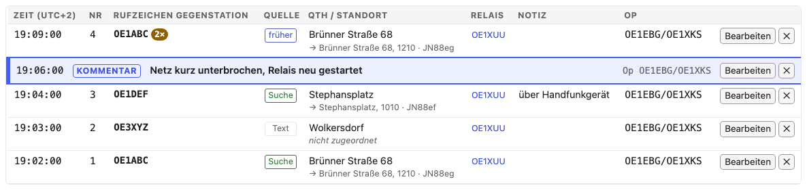
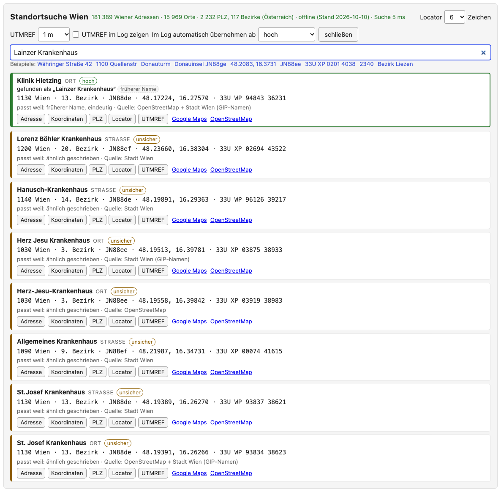
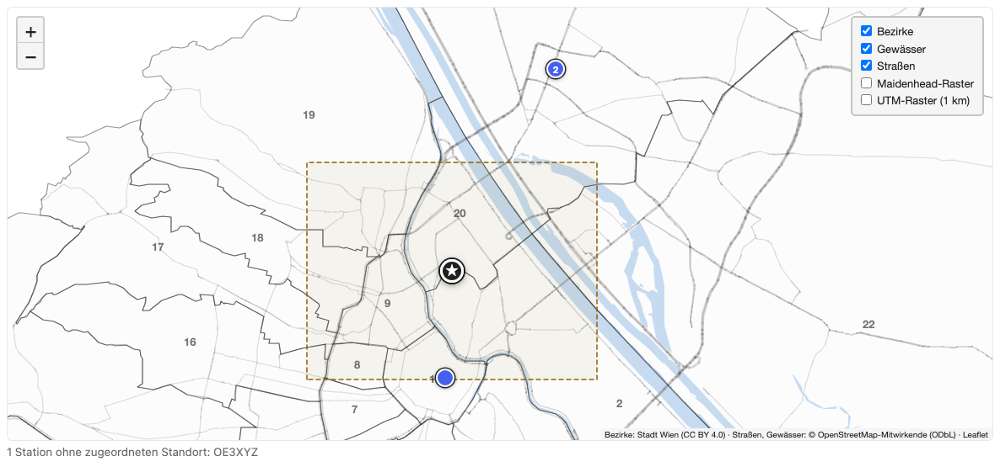
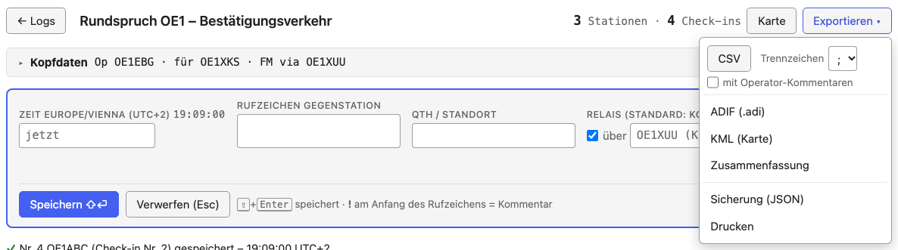
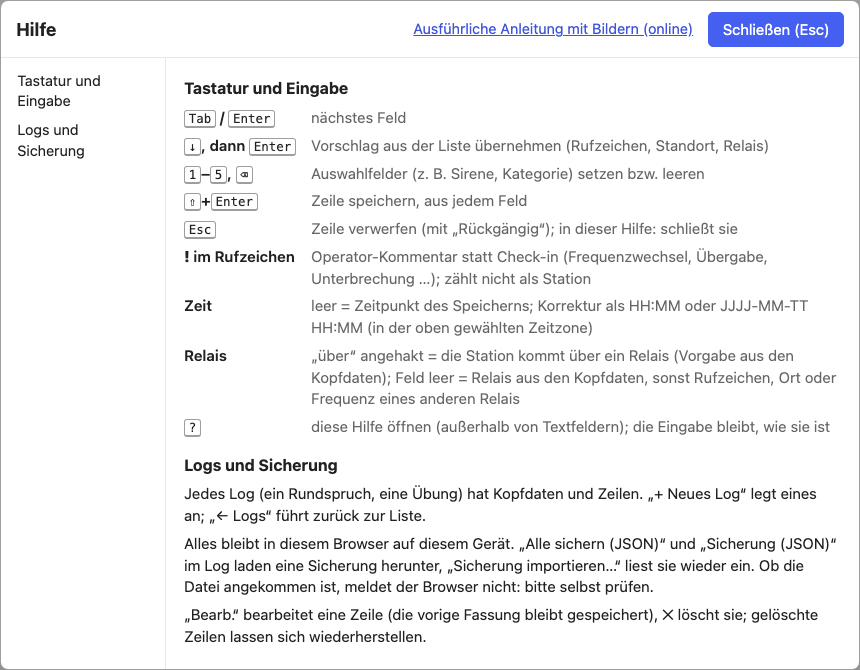

# Bestätigungsverkehr: Anleitung

[Bestätigungsverkehr öffnen →](confirm/index.html){ .tool-launch }
[Alle Tools](index.md) ·
[Offline-Datei](confirm/confirm-offline.html){ download="bestaetigungsverkehr-offline.html" } ·
[Datenquellen](data-sources.md#bestatigungsverkehr-confirmation-log) ·
[Quellcode](https://github.com/oe1ebg/tools/tree/main/tools/confirm)
{ .tool-actions }

Der [Bestätigungsverkehr](confirm/index.html) ist ein Logbuch für Runden, in
denen sich Stationen nur melden: Bestätigungsverkehr nach einem Rundspruch,
RST-Runden oder Umfragen wie den Zivilschutz-Probealarm. Er läuft vollständig
im Browser und ohne Internet; alle Daten bleiben auf dem Gerät.

Die Kurzfassung steht im Werkzeug selbst: **„? Hilfe“** ganz rechts in der
Kopfzeile oder die Taste <kbd>?</kbd> (außerhalb von Textfeldern).

## Kurz: so geht's los

1. [Bestätigungsverkehr öffnen](confirm/index.html), einmal mit Internet;
   danach läuft er auch offline ([Vorbereitung](#vorbereitung)).
2. „+ Neues Log“: Titel und Vorlage wählen ([Ein Log anlegen](#ein-log-anlegen)),
   dann Operator, Station und Relais eintragen ([Betrieb](#betrieb)).
3. Das erste Rufzeichen eintippen und mit <kbd>⇧</kbd>+<kbd>Enter</kbd>
   speichern ([Check-ins aufnehmen](#check-ins-aufnehmen)).
4. Am Ende „Exportieren ▾“ → „Sichern (JSON)“, dazu CSV oder ADIF
   ([Export und Sicherung](#export-und-sicherung)).

## Vorbereitung

**Offline verwenden.** Beim ersten Öffnen mit Internet lädt das Werkzeug
alles, was es braucht: die österreichische Rufzeichenliste, die Relaisliste
des ÖVSV, Wiener Adressen und Orte, österreichische Postleitzahlen und
Bezirke sowie die Karte. Danach funktioniert es ohne Verbindung; „offline
bereit ✓“ oben rechts zeigt das an. Am Handy oder Tablet über „Zum
Startbildschirm hinzufügen“ als App ablegen. Für Laptops ohne Internet gibt es
die **Offline-Datei** (eine HTML-Datei, etwa 7 MB, unten auf der Startseite),
etwa für einen USB-Stick.

**Speicher.** „Speicher dauerhaft ✓“ heißt, der Browser löscht die Daten
nicht von selbst. Steht dort „nicht dauerhaft“, regelmäßig eine Sicherung
(JSON) exportieren.

**Offline-Status.** „offline bereit ✓“ oben rechts heißt: alles ist
im Browser gespeichert. „offline: lädt…“ dauert beim ersten
Öffnen kurz. „offline nicht bereit“ heißt: der Browser hat die
Offline-Kopie gelöscht; mit Internet geöffnet, repariert sie sich selbst
(„Offline-Kopie wird repariert…“). Gibt es auf dem Server inzwischen eine
neue Version, steht „Neue Version auf dem Server – bitte aktualisieren“;
dann über „Neue Version verwenden“ wechseln. Bei „Offline-Einrichtung
fehlgeschlagen“ oder „Reparatur fehlgeschlagen“ die Seite mit Internet neu
laden.
„Entwicklungsmodus (nicht offline)“ gibt es nur auf
Entwicklungsservern.

**Neue Version.** Erscheint oben der Balken „Neue Version bereit“, ist eine
neue Version schon geladen. Sie wird erst mit „Jetzt verwenden“ aktiv, nicht
von selbst; „Später“ schließt den Balken, und „Neue Version verwenden“ in
der Kopfzeile erinnert bis zum nächsten Öffnen daran. Der
Klick lädt aber **alle** offenen Tabs und Fenster des Werkzeugs neu; einen
Aufschub, den man je Tab wählen kann, gibt es nicht. Gespeicherte Zeilen und
Logs bleiben unverändert. Vor dem Neuladen sichert jeder Tab die halb
getippte Zeile und den Betrieb als Entwurf und holt sie danach zurück.
Gelingt das Sichern in einem Tab nicht (zum Beispiel bei vollem Speicher),
wird dieser Tab **nicht** neu geladen: die Eingabe bleibt stehen, der Knopf
heißt „Update wartet: Eingabe klären“, und eine rote Meldung unter der
Kopfzeile sagt, was nicht gesichert ist. Dort kann man den Text in die
Zwischenablage kopieren (geht das nicht, erscheint er zum Markieren und
Kopieren von Hand), „Erneut versuchen“ oder, mit Rückfrage, „Trotzdem
aktualisieren“ (der genannte Text geht dann verloren). Hat ein anderer Tab
das Update schon installiert, steht dieselbe Meldung dort („Neuladen nicht
ausgeführt“), und die Seite läuft bis zum Neuladen mit der alten Version.
Schlägt das Laden der neuen Version oder die Suche danach fehl, steht
„Update fehlgeschlagen“ bzw. „Update-Prüfung fehlgeschlagen“ daneben; die
installierte Version läuft weiter. **Trotzdem vor jedem Update:** fertige
Zeilen speichern (<kbd>⇧</kbd>+<kbd>Enter</kbd>) und wichtige unfertige
Eingaben außerhalb des Werkzeugs kopieren. Ein Entwurf ist keine gespeicherte
Zeile, und die Sicherung (JSON) enthält keine unfertigen Eingaben (siehe
[Gespeichert, Entwurf und Sicherung](#gespeichert-entwurf-und-sicherung)).

**Mehrere Tabs.** Ein Log sollte nur in einem Tab offen sein; sonst warnt
das Werkzeug („nur ein Tab pro Log!“).

## Gespeichert, Entwurf und Sicherung

**Gespeichert** heißt: die Zeile ist im Speicher des Browsers abgeschlossen
(„gespeichert“ erscheint erst danach). Schlägt das Speichern fehl, erscheint
ein rotes Banner und die Eingabe bleibt im Formular.

**Entwurf** ist die halb getippte Zeile. Sie wird laufend zwischengesichert
und nach einem Neuladen oder Absturz zurückgeholt, kann aber verloren gehen
(zum Beispiel wenn der Browser die Website-Daten löscht oder der Speicher
voll ist). Was zählt, ist die gespeicherte Zeile.

**Sicherung (JSON).** „Download gestartet“ ist nicht „Sicherung
aufbewahrt“: Der Browser meldet dem Werkzeug nur, dass er die Datei
bekommen hat, nicht ob und wo sie liegt. Eine Sicherung ist erst eine
Sicherung, wenn die Datei an einem Ort liegt, den Sie kontrollieren (anderer
Datenträger, USB-Stick, anderer Rechner). Probieren Sie den Import
gelegentlich aus. Die Sicherung ist eine Momentaufnahme dieses Logs mit
allen Zeilen, auch den gelöschten, und enthält die Daten **unverschlüsselt**.

**Wiederherstellen.** „Wiederherstellen…“ auf der Startseite liest eine Sicherung ein:

- Die Datei wird zuerst geprüft. Ist sie keine gültige Sicherung des
  Bestätigungsverkehrs, wird nichts importiert und nichts verändert.
- Alle Logs der Datei werden **ganz oder gar nicht** übernommen.
- Sehr große Sicherungen (über 50 MB oder 200000 Zeilen und Versionen) werden
  beim Sichern automatisch in mehrere Dateien „…_teil-1-von-3.json“ usw.
  geteilt, nichts geht verloren. Beim Importieren **alle Teile gemeinsam
  auswählen** (in der Dateiauswahl mehrere Dateien markieren): sie werden
  wie eine einzige Sicherung, ganz oder gar nicht, übernommen. Fehlt ein Teil,
  wird nichts importiert und die Meldung nennt den fehlenden Teil.
  Der Browser fragt dabei eventuell, ob mehrere Downloads erlaubt sind; die
  Meldung sagt nur, dass N Dateien gestartet wurden – **prüfen Sie, dass alle
  N angekommen sind** (die Sicherung gilt dann nicht automatisch als
  gemacht). Die Teile lassen sich nur im Bestätigungsverkehr importieren, und
  nur mit einer aktuellen Version des Werkzeugs: eine ältere Version könnte
  einen einzelnen Teil als unvollständige Sicherung einspielen. Alle Teile
  zusammen dürfen höchstens 12 Dateien, 480 MB und 1000000 Zeilen und
  Versionen umfassen. Ist ein Log dafür zu groß, meldet das Werkzeug „Zu groß
  für eine einzige Sicherung“ **bevor** etwas heruntergeladen wird: dann die
  Logs einzeln sichern. Auch ein einzelner sehr langer Text (eine Notiz oder
  ein Kommentar über 50 MB) wird dabei auf mehrere Teile verteilt und beim
  Import wieder zusammengesetzt; fehlt ein Stück, wird nichts importiert.
  Eine einzelne Datei darf höchstens 50 MB und 200000
  Zeilen und Versionen enthalten.
- Es wird nie etwas Vorhandenes überschrieben. Ist die ID des Logs, einer
  seiner Zeilen oder einer früheren Fassung schon gespeichert, kommt das Log
  als Kopie mit neuen IDs und dem Zusatz „(Import)“ dazu. Andere Logs
  behalten ID und Titel.
- Ältere Sicherungen lassen sich importieren. Fehlt etwas oder weicht etwas
  ab, steht es als Hinweis unter „Hinweise zur Sicherung“. Es wird nichts
  weggelassen; nötige Werte werden bei Bedarf ergänzt (z. B. der
  Zähler für die nächste Nummer), und eine Zeile ohne lesbare Zeit
  bekommt ihre Erstellungs- bzw. Exportzeit, mit Hinweis.

**Ersatzspeicher.** Steht in der Fußzeile „localStorage (Ersatzspeicher)“, war
IndexedDB nicht verfügbar. Der Ersatzspeicher ist klein (rund 5 MB) und hat
bei einer Adresse mit `http://` (statt HTTPS oder `localhost`) keine
Sperre zwischen Tabs: zwei Tabs könnten dann gleichzeitig schreiben. Nur
einen Tab pro Log verwenden und häufig sichern. Läuft das Werkzeug später
wieder mit IndexedDB, bietet es an, die Datensätze aus dem Ersatzspeicher zu
übernehmen („In IndexedDB übernehmen“). Das Angebot überschreibt nichts, was
in IndexedDB steht; Datensätze, die sich nicht übernehmen lassen (zum
Beispiel weil sie von den gespeicherten abweichen), bleiben im Ersatzspeicher
und werden mit Grund aufgelistet; „Als JSON sichern“ lädt sie herunter.

**Daten schützen.** Die Daten liegen im Browser dieses Geräts und, als
Sicherung, in Dateien, jeweils unverschlüsselt. Gerät und Benutzerkonto
schützen (Festplattenverschlüsselung, Sperrbildschirm) und auf einem
gemeinsam genutzten Rechner ein eigenes Browserprofil verwenden. Der Browser
trennt die Daten nach Adresse (Rechnername und Port), nicht nach
Verzeichnis: Andere Seiten derselben Adresse können sie lesen. Betreibt eine
Organisation das Werkzeug selbst, sollte sie es auf einer eigenen Adresse
bereitstellen. Die Offline-Datei und die Seite im Netz haben getrennte
Speicher; zum Umziehen die Sicherung verwenden. Der Verlauf der Änderungen
(frühere Fassungen) schützt vor Versehen, nicht vor Manipulation.

## Ein Log anlegen

„+ Neues Log“ auf der Startseite:

- **Titel**, z. B. „Rundspruch OE1 – Bestätigungsverkehr“.
- **Vorlage:** welche Felder eine Zeile hat.
  - *Bestätigungsverkehr:* Rufzeichen und QTH / Standort.
  - *Rufzeichen + RST:* Name, RST gegeben (wie wir die Station hören) und erhalten (wie sie uns hört), QTH; „/“ im ersten RST-Feld springt ins zweite.
  - *Zivilschutz-Probealarm:* Standort mit PLZ, Hörbarkeit der Sirene
    (Schulnote 1–5) innen bei geschlossenem und offenem Fenster und im
    Freien, AT-Alert erhalten, sonst Handy und Version.

  „So sieht eine Logzeile mit dieser Vorlage aus“ zeigt ein Beispiel.
- **Betrieb** (siehe unten). Ein neues Log übernimmt den Betrieb des
  zuletzt angelegten.

Mit <kbd>⇧</kbd>+<kbd>Enter</kbd> oder „Log anlegen“ geht es los.

## Betrieb

Der Betrieb steht aufklappbar über dem Eingabefeld und gilt für neue
Zeilen. Gespeicherte Zeilen behalten Operator, Station, Frequenz und Relais
vom Zeitpunkt des Eintrags.

| Feld | Bedeutung | Beispiel |
| --- | --- | --- |
| Operator | wer funkt | OE1EBG |
| Station (für) | für welche Station (Klubstation, Sonderrufzeichen) | OE1XKS |
| Eigener QTH | der eigene Standort, mit Ortssuche | Wien 1220, Wagramer Straße |
| Eigener Locator | Maidenhead-Locator des eigenen Standorts | JN88ef |
| Betriebsart | FM, DMR, C4FM, D-STAR, M17, TETRA, SSB … | FM |
| Verbindung | direkt (Simplex) oder über Relais | über Relais |
| Frequenz MHz | bei direkt | 145,500 |
| Relais | Rufzeichen, Ort oder Frequenz (MHz) eines Relais aus der ÖVSV-Liste (das Feld zeigt dann sein Rufzeichen); setzt Ausgabe, Shift und Signalisierung | OE1XUU |

Ein **Wechsel von Operator oder Relais/Frequenz** schreibt automatisch eine
Markierung ins Log („OE1XYZ übernimmt von OE1ABC“, „OE1XUU → direkt“). Ihr
Text lässt sich ergänzen.

Bei geschlossenem Panel zeigt dessen Zeile alles, was eingestellt ist:
Operator, Station, QTH und Locator, Betriebsart sowie direkte Frequenz oder
Relais mit Shift und Signalisierung. In einem Feld setzt <kbd>Esc</kbd> den
Wert zurück, den es vor dem Bearbeiten hatte. „Rückgängig“ stellt den Betrieb
wieder her, wie er beim Öffnen des Panels war; automatische Markierungen, die
diese Änderungen geschrieben haben, kommen in den Papierkorb, sofern ihr Text
nicht bearbeitet wurde.

## Check-ins aufnehmen

- **Rufzeichen** (der Gegenstation) eintippen. Die Vorschläge kommen aus diesem und
  früheren Logs und aus der Rufzeichenliste (Name und Ort stehen darunter).
  <kbd>↓</kbd> und <kbd>Enter</kbd> übernimmt einen Vorschlag. Ohne Markierung
  übernimmt <kbd>Enter</kbd> nur einen Vorschlag, der das Getippte vervollständigt;
  ein vollständig getipptes, unbekanntes Rufzeichen bleibt, wie es ist.
- **Zeit:** leer = Zeitpunkt des Speicherns. Korrektur als `19:42` oder
  `2026-10-08 19:42`, in der oben gewählten Zeitzone (UTC oder lokal).
- **QTH / Standort** (siehe [Standort](#standort)).
- **Relais:** ist mit dem Relais aus dem Betrieb vorbelegt. Leer = die
  Station kam direkt (ohne Relais; das leere Feld zeigt „direkt“). Für ein
  anderes Relais dessen Rufzeichen, Ort oder Frequenz eintragen (dann orange
  markiert); <kbd>Esc</kbd> stellt das Relais aus dem Betrieb wieder her.
- **Notiz:** freier Text.
- <kbd>⇧</kbd>+<kbd>Enter</kbd> speichert, aus jedem Feld. <kbd>Esc</kbd> verwirft die Zeile, mit
  „Rückgängig“.

**Wiederholte Check-ins.** Meldet sich eine Station ein weiteres Mal, zeigt
das Formular die früheren Check-ins und bietet „Werte vom letzten Check-in
übernehmen“ an. Im Log steht die Anzahl neben dem Rufzeichen (2×).

**Operator-Kommentare.** Der Schalter **Check-in | Kommentar** über dem
Formular stellt auf einen Kommentar statt eines Check-ins um: für einen
Operatorwechsel, „Netz pausiert“, „Wechsel auf 145,500“. Schneller per
Tastatur: die Eingabe im Rufzeichenfeld mit **`!`** beginnen („!Netz
pausiert“). Eine halb getippte Zeile der anderen Art geht dabei nie
verloren: erst speichern oder verwerfen. Eine Kategorie (Frequenzwechsel, Schichtwechsel /
Übergabe, Unterbrechung, Technik, Sonstiges) wählt man mit den Ziffern
<kbd>1</kbd>–<kbd>5</kbd>. Kommentare zählen nicht als Station und kommen nie ins ADIF.

## Das Log

Neueste Zeile oben. Oben stehen die Zahlen: Stationen und Check-ins.
„Bearbeiten“ ändert eine Zeile (die vorige Fassung bleibt gespeichert), ✕
löscht sie (wiederherstellbar unter „Gelöschte Zeilen und automatische
Sicherungen“).

Zusammengehöriges steht in einer Zelle, damit eine Zeile kurz bleibt: der
Name unter dem Rufzeichen, der Rapport als „erhalten / gegeben“, beim
Standort darunter klein PLZ, Locator und woher der Standort kommt: *Suche*
(Ortssuche), *früher* (aus einem früheren Check-in), *Call* (Lizenzadresse
aus der Rufzeichenliste); grau „nicht zugeordnet“ heißt, der Text wurde
keinem Ort zugeordnet. Beim Zivilschutz-Probealarm zeigt **Sirene** die drei
Schulnoten (zu · offen · außen, grün bis rot) und **AT-Alert** „✓ erhalten“
oder „✕ fehlt“ mit Handy und Version. **Relais** zeigt in jeder Zeile
das Relais, über das die Station kam, oder „direkt“; gestrichelt umrandet,
wo die Zeile vom Betrieb abweicht (ein anderes Relais, direkt statt über das
Relais oder umgekehrt). Der **Operator** steht nur in einer abweichenden
Zeile, am Anfang der Notiz („Op OE1ABC“). Die Spaltennamen sind kurz; mit der Maus darüber steht die
Erklärung.

Am Handy ist jede Zeile eine Karte: oben Zeit, Nummer, Rufzeichen und die
Knöpfe, darunter die übrigen Spalten mit ihrem Namen (leere fehlen).

## Standort

Das Feld QTH / Standort und die Standortsuche (📍 Standort oben rechts)
finden offline:

- Wiener Adressen, Straßenecken („Praterstern / Lassallestraße“), Plätze,
  Haltestellen, Spitäler, Schulen und andere bekannte Orte, auch unter
  umgangssprachlichen oder früheren Namen;
- Orte um Wien und für ganz Österreich Postleitzahlen, Gemeinden und
  Bezirke;
- Koordinaten, Maidenhead-Locator und UTMREF (MGRS).

Ein sicherer Treffer wird automatisch übernommen (✓ mit „exakt“ oder „hoch“),
sonst wählt man aus den Vorschlägen. Was nicht zugeordnet werden kann, wird
als Text gespeichert. In der Standortsuche lassen sich die Genauigkeit des
Locators und des UTMREF und die Schwelle für die automatische Übernahme
einstellen.

## Karte

„Karte“ zeigt alle Stationen mit Standort auf einer Wien-Karte, ohne
Internet: Bezirke, Gewässer, Hauptstraßen und auf Wunsch das Locator-Gitter.
Ein Stern ist der eigene Standort, eine Zahl am Punkt zeigt wiederholte
Check-ins. Ein unsicherer Treffer ist ein hohler, gestrichelter Kreis.
Stationen ohne Standort stehen unter der Karte.

## Export und Sicherung

„Exportieren ▾“:

| Export | Inhalt |
| --- | --- |
| CSV | eine Zeile pro Check-in, für Excel; Trennzeichen `;` (deutsches Excel) oder `,`; optional mit Operator-Kommentaren. Werte, die mit `=`, `+`, `-` oder `@` beginnen (z. B. eine Notiz „- Akku leer“), bekommen ein `'` vorangestellt, damit Excel sie nicht als Formel ausführt; Zahlen wie `-10` bleiben unverändert |
| ADIF (.adi) | für Logbuchprogramme, ADIF 3.1.7; über Relais mit `PROP_MODE=RPT` |
| KML (Karte) | Stationen mit Standort für Google Earth / Google My Maps |
| Zusammenfassung | Text: Rufzeichen, Statistik (beim Probealarm Sirenen-Noten und AT-Alert), Standorte, Kommentare und Operators |
| Sichern (JSON) | das ganze Log, auch gelöschte Zeilen; auf der Startseite mit „Wiederherstellen…“ wieder einspielen |
| Drucken | das ganze Log als PDF, A4 quer, in den Spalten des Logs am Bildschirm; die Zeilen stehen in zeitlicher Reihenfolge (älteste zuerst), anders als am Bildschirm (neueste zuerst), gelöschte Zeilen fehlen. Auf jeder Seite stehen der Titel, alle Angaben zum Betrieb (Operator, Station, QTH, Locator, Betriebsart, Relais, Frequenz, Signalisierung), der Zeitraum von der ersten bis zur letzten Zeile, die Zeitzone (UTC oder Ortszeit, wie am Bildschirm eingestellt), die Vorlage und der Druckzeitpunkt; unten „Seite x von y“. Der volle Text jeder Notiz steht da, umbrochen; eine lange Zeile läuft auf der nächsten Seite weiter. Kommentare und Marker sind eigene, getönte Zeilen über die ganze Breite; ein Relais, das vom Betrieb abweicht, ist gestrichelt umrandet und mit „abweichend“ beschriftet; Sirenennoten stehen als Zahl in einem Kästchen – so ist alles auch auf einem Schwarzweißdrucker lesbar. Das PDF öffnet sich in einem neuen Tab (sonst wird es heruntergeladen) und druckt in jedem Browser gleich; beim Drucken „Tatsächliche Größe“ bzw. 100 % wählen |
| Leerformular (PDF) | ein leeres Blatt mit 15 Zeilen in den Spalten dieses Logs, alles von Hand auszufüllen; im Voraus drucken, für ein Netz ohne Gerät oder wenn eines ausfällt. Ein PDF (A4 quer, eine Seite), das sich in einem neuen Tab öffnet (sonst wird es heruntergeladen) und in jedem Browser gleich druckt; beim Drucken „Tatsächliche Größe“ bzw. 100 % wählen. Auch auf der Startseite („Leerformular ▾“, für jede Vorlage) |

Ein Hinweis neben dem Titel erinnert an eine Sicherung, wenn seit dem letzten
Export viele Zeilen dazugekommen sind. Auf der Startseite sichert „Alle
sichern (JSON)“ alle Logs auf einmal.

## Zeit: UTC oder lokal

Der Schalter **UTC / Lokal** oben rechts bestimmt, wie Zeiten angezeigt und
eingegeben werden. Die lokale Wahl nennt die Zeitzone des Geräts mit ihrem
Abstand zu UTC, etwa „Europe/Vienna (UTC+2)“. Gespeichert wird immer die genaue Zeit; CSV
(`zeitstempel_utc`) und ADIF bleiben in UTC.

## Tastatur

| Taste | Wirkung |
| --- | --- |
| <kbd>Tab</kbd> / <kbd>Enter</kbd> | nächstes Feld |
| <kbd>↓</kbd>, dann <kbd>Enter</kbd> | Vorschlag übernehmen (Rufzeichen, Standort, Relais) |
| <kbd>1</kbd> – <kbd>5</kbd>, <kbd>⌫</kbd> | Auswahlfelder (z. B. Sirene, Kategorie) setzen bzw. leeren |
| <kbd>⇧</kbd>+<kbd>Enter</kbd> | Zeile speichern, aus jedem Feld |
| <kbd>Esc</kbd> | Zeile verwerfen (mit „Rückgängig“) |
| `!` am Anfang des Rufzeichens | Operator-Kommentar statt Check-in |
| <kbd>?</kbd> | Hilfe öffnen (außerhalb von Textfeldern); <kbd>Esc</kbd> schließt sie |

---

[Bestätigungsverkehr öffnen →](confirm/index.html){ .tool-launch }
{ .tool-actions }
