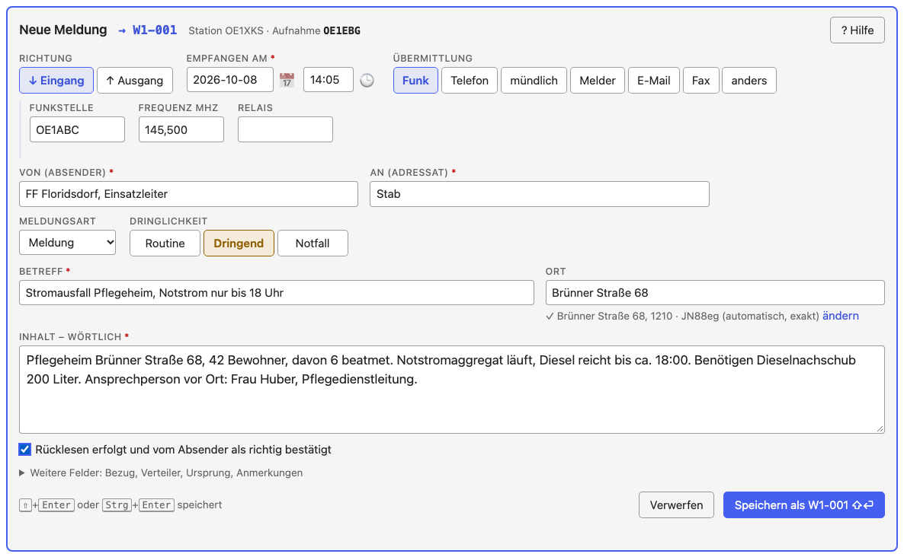

# Notfunk-Meldebuch: Anleitung

[Notfunk-Meldebuch öffnen →](notfunk/index.html){ .tool-launch }
[Alle Tools](index.md) ·
[Offline-Datei](notfunk/notfunk-offline.html){ download="notfunk-meldebuch-offline.html" } ·
[English](notfunk-manual.md) ·
[Datenquellen](data-sources.md#notfunk-meldebuch) ·
[Quellcode](https://github.com/oe1ebg/tools/tree/main/tools/notfunk)
{ .tool-actions }

Das [Notfunk-Meldebuch](notfunk/index.html) ist ein Meldebuch für den
Notfunk: Meldungen aufnehmen, lückenlos nummerieren, an die
Meldesammelstelle übergeben, übertragen und ausdrucken. Es läuft vollständig
im Browser und ohne Internet; alle Daten bleiben auf dem Gerät. Es ist für
den Notfunk in Wien gedacht (Notfunknetz Wien des
[Notfunkreferats Wien im ÖVSV](#quellen)).

!!! warning "Entwurf"
    Das Meldungsformat ist noch nicht mit dem Notfunkreferat Wien und der
    Meldesammelstelle abgestimmt. Felder, Bezeichnungen und die
    Dringlichkeitsstufen können sich ändern. Für Übungen gedacht.

Die Anleitung hat drei Teile:

1. **[Einführung](#einfuhrung-der-weg-einer-notmeldung):** wie eine
   Notmeldung von der Lichtinsel zum Kriseneinsatzstab und die Antwort
   zurück gelangt, und was Funkamateure dabei tun (und nicht tun).
2. **[Tutorial](#tutorial-eine-notmeldung-von-der-lichtinsel-zum-stab):** das
   Meldebuch Schritt für Schritt an einem Beispiel, in etwa zehn Minuten.
3. **[Referenz](#referenz):** alle Felder, Anzeigen, Exporte und Tasten.

Die Kurzfassung steht im Werkzeug selbst: **„? Hilfe“** ganz rechts in der
Kopfzeile, <kbd>F1</kbd> oder <kbd>?</kbd> (außerhalb von Textfeldern).
Die Quellen dieser Anleitung stehen am Ende unter [Quellen](#quellen).

## Einführung: der Weg einer Notmeldung

### Die Lage

Bei einem großflächigen Ausfall der Kommunikation, etwa einem Blackout,
funktionieren die üblichen Wege nicht mehr: Notrufe über das Telefon oder
das Handy erreichen die Leitstellen nicht. In Wien richtet die Stadt für
diesen Fall **Lichtinseln** ein, Anlaufstellen der Religionsgemeinschaften
(Pfarren, Moscheen, Tempel und andere), in denen Bürgerinnen und Bürger
Hilfe und Information bekommen. Die Lichtinseln sind mit Funk ausgerüstet
und, wo es sich ausgeht, mit Funkamateuren des Notfunkreferats besetzt. So
kommt eine Meldung aus der Nachbarschaft zum Krisenmanagement der Stadt,
auch wenn sonst nichts mehr geht ([Quellen](#quellen): Richtlinie, Lichtinseln).

### Der Weg einer Meldung

Kommen Menschen mit einem Notfall zur Lichtinsel, wird ihre Meldung
**aufgenommen**, **funkend weitergegeben**, im Stab **übernommen** und
entschieden; die Antwort geht denselben Weg **zurück**.

<figure class="diagram">
<svg viewBox="0 0 1048 430" role="img" aria-labelledby="nf-ablauf-t nf-ablauf-d" xmlns="http://www.w3.org/2000/svg" fill="currentColor" font-family="inherit" font-size="14">
<title id="nf-ablauf-t">Der Weg einer Notmeldung und der Rückweg der Antwort</title>
<desc id="nf-ablauf-d">Von links nach rechts: Hilfesuchende kommen zur Lichtinsel, wo ein Funkamateur die Meldung aufnimmt und zurückliest. Über das lokale Informationsnetz geht sie an den K-Vorsorgestandort, von dort über BOS-Funk oder das taktische Netz an die Meldesammelstelle der Einsatzleitstelle und im Haus an den Kriseneinsatzstab. Die Antwort nimmt denselben Weg zurück bis zu den Hilfesuchenden.</desc>
<defs>
<marker id="nf-pfeil" viewBox="0 0 10 10" refX="9" refY="5" markerWidth="8" markerHeight="8" orient="auto-start-reverse"><path d="M0 0L10 5L0 10z" fill="currentColor"/></marker>
</defs>
<g font-size="13" text-anchor="middle" fill-opacity=".8">
<text x="195" y="60">mündlich,</text><text x="195" y="76">schriftlich</text>
<text x="409" y="60">Funk: lokales</text><text x="409" y="76">Informationsnetz</text>
<text x="623" y="44">BOS-Funk, Backup:</text><text x="623" y="60">taktisches Netz</text><text x="623" y="76">(Amateurfunk, DMR)</text>
<text x="837" y="60">Übergabe im Haus</text><text x="837" y="76">(Papier, mündlich)</text>
</g>
<g stroke="currentColor" stroke-width="1.5" fill="none">
<rect x="10" y="100" width="172" height="170" rx="8" stroke-dasharray="6 5"/>
<rect x="224" y="100" width="172" height="170" rx="8" stroke-width="3" fill="currentColor" fill-opacity=".08"/>
<rect x="438" y="100" width="172" height="170" rx="8" stroke-width="3" fill="currentColor" fill-opacity=".08"/>
<rect x="652" y="100" width="172" height="170" rx="8" stroke-width="3" fill="currentColor" fill-opacity=".08"/>
<rect x="866" y="100" width="172" height="170" rx="8" stroke-dasharray="6 5"/>
</g>
<g text-anchor="middle">
<text x="96" y="132" font-weight="700" font-size="16">Hilfesuchende</text>
<text x="96" y="160">Bürgerinnen und Bürger</text>
<text x="96" y="182">kommen zur Lichtinsel</text>
<text x="96" y="236" font-size="13" fill-opacity=".8">kein Funkamateur</text>

<text x="310" y="132" font-weight="700" font-size="16">Lichtinsel</text>
<text x="310" y="160">Funkamateur</text>
<text x="310" y="182">nimmt den Wortlaut auf</text>
<text x="310" y="204">und liest zurück</text>
<text x="310" y="236" font-size="13" fill-opacity=".8">Meldung ↑ Ausgang</text>

<text x="524" y="132" font-weight="700" font-size="16">K-Vorsorgestandort</text>
<text x="524" y="160">Leitstelle des lokalen</text>
<text x="524" y="182">Informationsnetzes</text>
<text x="524" y="204">gibt weiter</text>
<text x="524" y="236" font-size="13" fill-opacity=".8">Weitergabe ↓ ↑</text>

<text x="738" y="132" font-weight="700" font-size="16">Meldesammelstelle</text>
<text x="738" y="160">der Einsatzleitstelle,</text>
<text x="738" y="182">Funkstelle OE1XKS</text>
<text x="738" y="204">übergibt an den Stab</text>
<text x="738" y="236" font-size="13" fill-opacity=".8">Meldung ↓ Eingang</text>

<text x="952" y="132" font-weight="700" font-size="16">Kriseneinsatzstab</text>
<text x="952" y="160">(Krisenmanagement)</text>
<text x="952" y="182">entscheidet und</text>
<text x="952" y="204">veranlasst Hilfe</text>
<text x="952" y="236" font-size="13" fill-opacity=".8">kein Funkamateur</text>
</g>
<g stroke="currentColor" stroke-width="2.5" fill="none">
<path d="M186 160H220" marker-end="url(#nf-pfeil)"/>
<path d="M400 160H434" marker-end="url(#nf-pfeil)"/>
<path d="M614 160H648" marker-end="url(#nf-pfeil)"/>
<path d="M828 160H862" marker-end="url(#nf-pfeil)"/>
<g stroke-dasharray="7 4">
<path d="M862 220H828" marker-end="url(#nf-pfeil)"/>
<path d="M648 220H614" marker-end="url(#nf-pfeil)"/>
<path d="M434 220H400" marker-end="url(#nf-pfeil)"/>
<path d="M220 220H186" marker-end="url(#nf-pfeil)"/>
</g>
</g>
<g text-anchor="middle" font-size="13" font-weight="700">
<g stroke="currentColor" stroke-width="3" fill="none"><circle cx="203" cy="140" r="11"/><circle cx="417" cy="140" r="11"/><circle cx="631" cy="140" r="11"/><circle cx="845" cy="140" r="11"/></g>
<g stroke="currentColor" stroke-width="2" fill="none"><circle cx="845" cy="240" r="11"/><circle cx="631" cy="240" r="11"/><circle cx="417" cy="240" r="11"/><circle cx="203" cy="240" r="11"/></g>
<text x="203" y="145">1</text><text x="417" y="145">2</text><text x="631" y="145">3</text><text x="845" y="145">4</text>
<text x="845" y="245">5</text><text x="631" y="245">6</text><text x="417" y="245">7</text><text x="203" y="245">8</text>
</g>
<g stroke="currentColor" stroke-width="2" fill="none">
<path d="M224 296V306H824V296"/>
</g>
<text x="524" y="328" text-anchor="middle" font-weight="700">Hier arbeiten Funkamateure: sie übermitteln, was aufgenommen wurde –</text>
<text x="524" y="348" text-anchor="middle" font-weight="700">wörtlich, ohne Zusatz, ohne eigene Bewertung.</text>
<g font-size="13">
<path d="M10 396H60" stroke="currentColor" stroke-width="2.5" marker-end="url(#nf-pfeil)"/>
<text x="68" y="401">1 – 4 Meldung (hin)</text>
<path d="M300 396H350" stroke="currentColor" stroke-width="2.5" stroke-dasharray="7 4" marker-end="url(#nf-pfeil)"/>
<text x="358" y="401">5 – 8 Rückmeldung (zurück), z. B. „Hilfe ist unterwegs“</text>
</g>
</svg>
<figcaption>Der Weg einer Notmeldung (Zahlen 1 bis 4) und der Rückweg der Antwort (5 bis 8). Fett umrandet: dort arbeiten Funkamateure.</figcaption>
</figure>

**Hin:**

1. **Aufnehmen.** Eine Person schildert den Notfall. Der Funkamateur an der
   Lichtinsel schreibt den Wortlaut auf (Meldeaufnahmeformular oder
   Meldebuch) und **liest ihn zurück**; die Person bestätigt, dass es stimmt.
2. **Funken.** Die Meldung geht im lokalen Informationsnetz an den
   zuständigen K-Vorsorgestandort ([Betriebsregeln](#betriebsregeln-in-kurze)).
   Der Empfänger liest sie ebenfalls zurück. Ist die Lichtinsel in kein lokales Netz eingecheckt,
   läuft es über das Informationsnetz Wien.
3. **Weitergeben.** Vom K-Vorsorgestandort geht die Meldung an die
   Einsatzleitstelle (ELS) des Krisenmanagements, normalerweise über
   BOS-Funk, als Backup über das taktische Amateurfunknetz. Dort nimmt die
   Amateurfunkstelle in der **Meldesammelstelle** sie auf (OE1XKS, solange
   die Einsatzleitstelle am üblichen Ort arbeitet; sonst hat sie ein
   anderes Rufzeichen).
4. **Übergeben.** Die Meldesammelstelle übergibt die Meldung im Haus an den
   **Kriseneinsatzstab** (Papier, mündlich). Hier endet die Aufgabe der
   Funkamateure: Was der Stab damit macht, entscheidet er.

**Zurück:**

5. Der Stab entscheidet und antwortet, zum Beispiel: „Diesel ist unterwegs,
   Ankunft 15:30.“
6. Die Meldesammelstelle nimmt die Antwort auf, funkt sie an den
   K-Vorsorgestandort und lässt sie zurücklesen.
7. Der K-Vorsorgestandort gibt sie im lokalen Informationsnetz an die
   Lichtinsel weiter.
8. Der Funkamateur an der Lichtinsel nimmt die Antwort auf, liest sie zurück
   und **sagt sie der Person, die den Notfall gemeldet hat**: „Hilfe ist
   unterwegs.“

Zwei Rückmeldungen sind zu unterscheiden:

- Die **Übernahme** („Meldung angekommen, Referenz GZ 0412“) bestätigt nur,
  dass die Meldung beim Stab liegt. Sie kommt rasch und sagt nichts über die
  Hilfe.
- Die **Antwort** („Hilfe ist unterwegs“) kommt, wenn der Stab entschieden
  hat. Sie ist eine eigene Meldung mit Bezug auf die ursprüngliche.

Welche Stationen der Weg im Einzelfall wirklich berührt, hängt von der Lage
ab. Das Bild zeigt den Regelweg der [Richtlinie Notfunk Teil 2 – Wien](#quellen).

### Was Funkamateure dabei tun, und was nicht

Funkamateure sind in dieser Kette **Überbringer**, mehr nicht. Die
Richtlinie sagt es so: Amateurfunkstellen sollen nicht selbst Nachrichten
erzeugen, sondern nur übermitteln.

| Das tun Funkamateure | Das tun sie nicht |
| --- | --- |
| den **Wortlaut** aufnehmen, wie er genannt wird | Inhalte deuten, ergänzen, kürzen oder „verbessern“ |
| **zurücklesen**, bis der Absender bestätigt | Vermutungen oder ungeprüfte Informationen weitergeben |
| funken, **Übergabe und Empfang** dokumentieren | Hilfe selbst veranlassen oder zusagen |
| die Antwort wörtlich weitergeben | eine lückenlose, nachvollziehbare Aufzeichnung führen | die Aufzeichnung später verändern, ohne dass die frühere Fassung bleibt |

Das Meldebuch ist so gebaut: Es nimmt den Wortlaut unverändert auf
(der Wortlaut bleibt unverändert gespeichert), vergibt lückenlose Nummern, hält jede
Fassung fest und zeigt, wer wann was übergeben hat.

### Wo das Meldebuch hineinpasst

Jede Station führt ein Meldebuch, jede Meldung hat eine Nummer. Der
Weg einer Meldung ist im Meldebuch der Status:

| Station | Richtung | Status im Meldebuch |
| --- | --- | --- |
| Lichtinsel, Meldung an den Stab | ↑ Ausgang | zur Übertragung → übertragen → Empfang bestätigt → beantwortet |
| Lichtinsel, Antwort des Stabs | ↓ Eingang | erfasst → übergeben (an die Person) → übernommen |
| Meldesammelstelle, Meldung von der Lichtinsel | ↓ Eingang | erfasst → übergeben (an den Stab) → übernommen (mit **Referenz** des Stabs) → beantwortet |
| Meldesammelstelle, Antwort des Stabs | ↑ Ausgang | zur Übertragung → übertragen → Empfang bestätigt |

Die **Notfunk-Nummer** (`W1-007`) gehört der Station, die **Referenz** der
Meldesammelstelle (Geschäftsbuch) dem Stab; das Meldebuch führt beide
getrennt, damit die Listen zusammenpassen.

### Betriebsregeln in Kürze

Aus der Richtlinie, soweit sie die Meldung betreffen (die Richtlinie
selbst gilt, nicht diese Zusammenfassung):

- Jeden Funkverkehr bei der Leitstelle anmelden; nur senden, was nötig ist;
  warten, bis man gerufen wird.
- Zwischen den Durchgängen das Relais abfallen lassen und eine Sekunde
  Pause machen, damit Notrufe gehört werden.
- Deutlich, langsam und ruhig sprechen; bei den Fakten bleiben.
- Funktagebuch führen und das Meldeaufnahmeformular benutzen. Die
  Richtlinie empfiehlt, **alle Aufzeichnungen auch auf Papier** zu führen
  (Betriebssicherheit): das Meldebuch ersetzt das Papier nicht, es ergänzt
  es. Dafür gibt es das leere Formular als PDF: [Leeres Formular (PDF) herunterladen](downloads/notfunk-vordruck.pdf){ download="notfunk-vordruck.pdf" } ([Ausdruck und PDF](#ausdruck-und-pdf)).
- Personenbezogene Daten sind zu löschen, wenn sie nicht mehr gebraucht
  werden (Richtlinie, Abschnitt Datenschutz). Das Meldebuch löscht nie von
  selbst; Einsätze und Sicherungen verwaltet man selbst.

Frequenzen und Netze der Richtlinie (Stand Ausgabe 1.0 vom 2024-10-20; die
aktuelle Ausgabe gilt):

| Netz | Frequenz | Zweck |
| --- | --- | --- |
| Informationsnetz Wien | 438,950 MHz (Relais Kahlenberg OE1XUU, Ablage −7,6 MHz, CTCSS 162,2 Hz); 438,650 MHz (Relais Laaerberg OE1XFW); 433,500 MHz bei Totalausfall der Relais | Ein- und Auschecken, allgemeine Nachrichten, Notmeldungen, wenn das lokale Netz nicht erreichbar ist |
| Lokale Informationsnetze | je Gruppe von Bezirken ein eigener UHF-Kanal (um 430 MHz) | Lichtinseln und Amateurfunkstellen mit dem K-Vorsorgestandort |
| Taktisches Netz | 70 cm, DMR | ELS und K-Vorsorgestandorte |
| Notruffrequenz | 145,500 MHz | wird nach Möglichkeit mitgehört |

## Tutorial: eine Notmeldung von der Lichtinsel zum Stab

Das Beispiel: Übung „Blackout Wien“. Sie sind Funkamateur an der Lichtinsel
Floridsdorf. Frau Huber, Pflegedienstleiterin eines Pflegeheims in der
Brünner Straße 68, kommt zu Fuß: Das Notstromaggregat läuft nur bis etwa
18 Uhr, 6 beatmete Bewohner sind in Gefahr. Sie brauchen Diesel. Rufzeichen
und Namen im Beispiel sind frei erfunden.

Zum Nachspielen gibt es eine fertige Datei:
[notfunk-full.json](https://github.com/oe1ebg/tools/blob/main/examples/backups/notfunk-full.json)
(über „Wiederherstellen…“ einspielen). Für das Tutorial legen Sie lieber
einen eigenen Einsatz an, dann sehen Sie jeden Schritt.

### 1. Vorbereiten

1. [Notfunk-Meldebuch öffnen](notfunk/index.html), einmal mit Internet; danach
   läuft es auch offline („offline bereit ✓“ oben rechts,
   [Vorbereitung](#vorbereitung)).
2. **„+ Neuer Einsatz“.** Tragen Sie ein: Einsatz „Übung Blackout Wien“,
   Stationskürzel **W1**, Ihr Stationsrufzeichen (hier OE1ABC), den Standort
   („Lichtinsel 12 Floridsdorf“), Ihr Rufzeichen als Operator, „Für Stelle“
   **Stab** und die Frequenz des lokalen Informationsnetzes.
   Dann „Einsatz anlegen“.

    

   Das Stationskürzel steht vor jeder Nummer. Hat die Lichtinsel zwei
   Geräte, bekommt jedes ein eigenes Kürzel (W1, W2), damit die Nummern nie
   doppelt vorkommen.

### 2. Die Meldung aufnehmen

Frau Huber schildert den Notfall. Sie nehmen im Formular oben auf. Weil Sie
die Meldung **weiterfunken**, ist die Richtung **Ausgang (↑)**.

1. **Richtung:** Ausgang. **Übermittlung:** Funk. **Funkstelle:** das
   Rufzeichen der Gegenstelle, an die Sie funken (hier OE1DEF, der
   K-Vorsorgestandort); Frequenz und Relais sind vorbelegt.
2. **Von:** „Pflegeheim Brünner Straße 68, Frau Huber“. **An:** „Stab“.
   Den Absender nennt die Person, nicht Sie.
3. **Dringlichkeit:** hier „Dringend“ (vor Routine zu übermitteln); „Notfall“
   ist für Gefahr für Leib und Leben, die sofort droht
   ([Dringlichkeit](#dringlichkeit)). Im Zweifel fragen Sie die Leitstelle.
4. **Betreff:** „Stromausfall Pflegeheim, Diesel benötigt“. **Ort:** die
   Adresse; beim Tippen schlägt die Ortssuche Treffer vor (offline).
5. **Inhalt – wörtlich:** der Wortlaut, wie ihn Frau Huber nennt.
6. **Rücklesen:** Lesen Sie die Meldung der Person vor. Sagt sie „stimmt“,
   setzen Sie das Häkchen (<kbd>Leertaste</kbd>).

    

7. **Speichern** mit <kbd>⇧</kbd>+<kbd>Enter</kbd>. Erst jetzt wird die
   Nummer vergeben, hier **W1-001**. Fehlt etwas, das nicht zwingend ist
   (zum Beispiel die Funkstelle), fragt das Formular nach; mit
   „Trotzdem speichern“ geht es weiter.

Die Meldung steht jetzt im Meldebuch mit dem Status **zur Übertragung**.

### 3. Funken und Übertragung festhalten

Sie rufen den K-Vorsorgestandort und lesen die Meldung vor. Der Empfänger
liest zurück.

1. Klicken Sie in der Zeile von W1-001 auf **„übertragen“**; es öffnet sich
   ein kleines Fenster. **Übertragen an:** das Rufzeichen der Gegenstelle,
   Zeitpunkt leer = jetzt; <kbd>Enter</kbd> trägt ein.
2. Hat die Gegenstelle zurückgelesen und die Übernahme bestätigt, tragen Sie
   „**Empfang bestätigt**“ ein (durch wen, wann).
3. Nennt die Meldesammelstelle später eine **Referenz** (hier „GZ 0412“),
   tragen Sie sie in der Meldung ein.

    

Der **Ablauf** rechts in der Meldung zeigt jeden Schritt mit Uhrzeit und
Operator. Hier endet Ihre Aufgabe für diese Meldung, bis die Antwort kommt.

### 4. Die Antwort entgegennehmen

Der Stab antwortet: „Tankwagen mit 200 Liter Diesel ist unterwegs, Ankunft
ca. 15:30.“ Die Antwort geht über die Meldesammelstelle und den
K-Vorsorgestandort an Sie.

1. Öffnen Sie W1-001 und wählen Sie **„Antwort erfassen“**. Das Formular
   kommt mit Richtung **Eingang**, vertauschtem Absender und Adressat und
   gesetztem Bezug „Antwort auf W1-001“.
2. Tragen Sie den **Wortlaut** der Antwort ein, lesen Sie zurück und
   speichern Sie (**W1-002**).
3. Die ursprüngliche Meldung W1-001 steht jetzt auf **beantwortet**.
4. Sagen Sie Frau Huber die Antwort, und halten Sie fest, dass Sie sie
   weitergegeben haben („übergeben“ an Frau Huber).

    

### 5. Am Ende

- **Sichern:** Der Sicherungsstand oben rechts zeigt, wie viele Meldungen
  noch nicht gesichert sind; ein Klick lädt eine Sicherung (JSON) herunter
  ([Exporte und Sicherung](#exporte-und-sicherung)). Legen Sie die Datei
  an einen sicheren Ort.
- **Drucken:** Das leere Formular für die Arbeit auf Papier: [Leeres Formular (PDF) herunterladen](downloads/notfunk-vordruck.pdf){ download="notfunk-vordruck.pdf" }. Eine einzelne Meldung als Formular, das ganze Meldebuch oder
  einen Zeitraum als PDF ([Ausdruck und PDF](#ausdruck-und-pdf)).
- **Schichtwechsel:** den Operator im Feld „Einsatz“ ändern.
- Wenn etwas schiefgeht (anderer Tab, Update, voller Speicher), sagen die
  Hinweise, was zu tun ist ([Speichern, Hinweise, Verwerfen](#speichern-hinweise-verwerfen)).

## Referenz

Die folgenden Abschnitte erklären jede Funktion im Einzelnen.

### Vorbereitung

**Offline verwenden.** Beim ersten Öffnen mit Internet lädt das Meldebuch
alles, was es braucht (Rufzeichenliste, Relaisliste, Wiener Adressen). Danach
funktioniert es ohne Verbindung. „offline bereit ✓“ oben rechts zeigt das an.
Steht dort „offline nicht bereit“, hat der Browser die Offline-Kopie
gelöscht; mit Internet geöffnet, repariert sie sich selbst („Offline-Kopie
wird repariert…“). Gibt es auf dem Server inzwischen eine neue Version,
steht „Neue Version auf dem Server – bitte aktualisieren“; dann über „Update
verfügbar“ aktualisieren. Bei „Offline-Einrichtung fehlgeschlagen“ oder
„Reparatur fehlgeschlagen“ die Seite mit Internet neu laden.
Am Handy oder Tablet über „Zum Startbildschirm hinzufügen“ als App ablegen.
Für Laptops ohne Internet gibt es die **Offline-Datei** (eine HTML-Datei,
etwa 7 MB, unten auf der Startseite des Werkzeugs), etwa für einen
USB-Stick.

**Daten sichern.** „Speicher dauerhaft ✓“ heißt, der Browser löscht die Daten
nicht von selbst. Steht dort „nicht dauerhaft“, ist eine regelmäßige
Sicherung umso wichtiger. Der Sicherungsstand steht oben rechts
(„Sicherung gestartet 14:40 · 3 Meldungen ungesichert“ oder „Sicherung
gestartet 14:40 · nichts ungesichert“, vorher „Noch keine Sicherung“); ein
Klick darauf lädt eine neue Sicherung (JSON) herunter. Die Zeit ist der
Moment, in dem das Meldebuch den Download **gestartet** hat; „ungesichert“
zählt die Meldungen, die seitdem neu oder geändert sind. Auch „nichts
ungesichert“ heißt nur: seit dem Start des Downloads ist nichts dazugekommen.
Ob die Datei vollständig angekommen ist und noch irgendwo liegt, kann das
Meldebuch nicht wissen; siehe
[Gespeichert, Entwurf und Sicherung](#gespeichert-entwurf-und-sicherung).

**Neue Version.** Erscheint oben der Balken „Neue Version bereit“, ist eine
neue Version schon geladen. Sie wird erst mit „Jetzt verwenden“ aktiv, nicht
von selbst; „Später“ schließt den Balken, und „Neue Version verwenden“ in
der Kopfzeile erinnert bis zum nächsten Öffnen daran. Der
Klick lädt aber **alle** offenen Tabs und Fenster des Meldebuchs neu; einen
Aufschub, den man je Tab wählen kann, gibt es nicht. Gespeicherte Meldungen
und die vergebenen Nummern bleiben unverändert. Vor dem Neuladen sichert
jeder Tab den halb ausgefüllten Entwurf und holt ihn danach zurück. Gelingt
das Sichern in einem Tab nicht (zum Beispiel bei vollem Speicher), wird
dieser Tab **nicht** neu geladen: die Eingabe bleibt stehen, der Knopf heißt
„Update wartet: Eingabe klären“, und eine rote Meldung unter der Kopfzeile
erklärt warum. Haben zwei Fenster verschiedene Entwürfe (ein Entwurf ist
eine noch nicht gespeicherte Meldung) oder wartet ein älterer Entwurf auf
Prüfung, bietet die Meldung die Wahl gleich an: „Meinen Text sichern“
ersetzt den Entwurf des anderen Fensters, „Entwurf des anderen Fensters
laden“ ersetzt den Text in diesem Fenster; bei einem älteren Entwurf
„anwenden“ (Ihr Text wird gesichert) oder „verwerfen“ (die gespeicherte
Fassung wird geladen). Danach läuft das Update von selbst weiter. „Erneut
versuchen“ und, mit Rückfrage (sie nennt, was verloren geht), „Trotzdem
aktualisieren“ gibt es immer. Hat ein anderer Tab das Update schon
installiert, steht dieselbe Meldung in dem Tab („Neuladen nicht
ausgeführt“); die Seite läuft bis zum Neuladen mit der alten Version.
**Trotzdem vor jedem Update:** fertige Meldungen speichern und wichtige
unfertige Eingaben außerhalb des Meldebuchs kopieren. Ein Entwurf ist keine
gespeicherte Meldung, und die Sicherung (JSON) enthält keine unfertigen
Eingaben. Im Einsatz lieber erst nach einer ruhigen Phase aktualisieren.

### Einen Einsatz anlegen

| Feld | Bedeutung | Beispiel |
| --- | --- | --- |
| Einsatz / Übung | Name des Einsatzes | Übung Blackout Wien |
| Stationskürzel | steht vor jeder Nummer; jedes Gerät bzw. jede Station eines Einsatzes bekommt ein eigenes | W1 |
| **Eigene Station:** | | |
| Stationsrufzeichen | Rufzeichen der eigenen Funkstation, z. B. die Klubstation; kann vom Rufzeichen des Operators abweichen | OE1XKS |
| Standort der Station (Adresse) | wo das eigene Funkgerät steht; steht oben im Ausdruck | Lichtinsel 12 Floridsdorf |
| Für Stelle | für wen die Station arbeitet: Adressat eingehender und Absender ausgehender Meldungen, solange nichts anderes eingetragen ist | Stab |
| Frequenz, Relais | Vorgabe für neue Meldungen; Relais leer = direkt | 145,500 · OE1XUU |
| **Am Gerät:** | | |
| Operator | wer am Gerät aufnimmt; beim Schichtwechsel ändern | OE1EBG |

Stationsrufzeichen und Operator werden bei jeder Meldung mitgespeichert: Im
Ausdruck steht „Aufgenommen von OE1EBG, an Station OE1XKS“, im Geschäftsbuch
(CSV) gibt es eine Spalte „Stationsrufzeichen“.

Alles außer dem Stationskürzel lässt sich später im aufklappbaren Feld
**„Einsatz“** über dem Formular ändern; Änderungen gelten für neue Meldungen.
Das Stationskürzel bleibt fest, sobald die erste Meldung gespeichert ist.

In einem Feld setzt <kbd>Esc</kbd> den Wert zurück, den es vor dem Bearbeiten
hatte (offene Vorschläge schließt <kbd>Esc</kbd> zuerst). „Rückgängig“ stellt
den Einsatz wieder her, wie er beim Öffnen des Feldes „Einsatz“ war; das
Stationskürzel bleibt, sobald Meldungen es verwenden. Ein Formular, das noch
die Vorgaben zeigt, folgt mit.

**Schichtwechsel:** im Feld „Einsatz“ den Operator ändern (oder oben im
Formular auf „Aufnahme OE1EBG“ klicken). Gespeicherte Meldungen behalten den
Operator, der sie aufgenommen hat.

### Der Ablauf einer Meldung

1. **Wortlaut aufnehmen:** den Inhalt wörtlich, wie übermittelt.
2. **Rücklesen bestätigen:** beim Eingang zurücklesen, der Absender bestätigt.
   Beim Ausgang liest die Funkstelle zurück.
3. **Meldung sichern:** Speichern vergibt die Notfunk-Nummer.
4. **Übergabe bzw. Übertragung dokumentieren:** bei der Meldung „übergeben“
   (Eingang) bzw. „übertragen“ (Ausgang) eintragen, danach die Bestätigung.
5. **Externe Referenz ergänzen:** die Nummer, die die Meldesammelstelle
   zurückmeldet.

„Übergeben“ oder „übertragen“ heißt nie, dass ein Auftrag im Inhalt erledigt
ist.

### Eine Meldung aufnehmen

Das Formular steht im Meldebuch ganz oben. Die nächste Nummer wird angezeigt
(„→ W1-008“), aber erst beim Speichern vergeben.

#### Die Felder

| Feld | Bedeutung | Beispiel |
| --- | --- | --- |
| Richtung | Eingang (↓) oder Ausgang (↑) | |
| Empfangen am / Gesendet am | wann die Meldung übermittelt wurde: Datum (JJJJ-MM-TT) und Uhrzeit (HH:MM, 24 Stunden) in zwei Feldern, Ortszeit. Zeigt von Anfang an jetzt und läuft mit der Uhr mit (grau), bis die Meldung begonnen wird; dann bleibt die Zeit stehen und kann korrigiert werden. `20261008` und `1405` gehen auch. Ein Klick ins Feld (oder 📅 / 🕒) öffnet einen Kalender bzw. eine Uhrzeit-Auswahl (Stunde, dann Minute), beide mit „Heute“ bzw. „Jetzt“. | 2026-10-08 · 14:05 |
| Übermittlung | Funk, Telefon, mündlich, Melder, E-Mail, Fax, anders | Funk |
| Funkstelle | die Funkstation, von der die Meldung gehört wurde (Eingang) bzw. an die sie gesendet wird (Ausgang); nur bei Funk | OE1ABC |
| Frequenz MHz, Relais | Vorgabe aus dem Einsatz; Komma oder Punkt; Relais leer = direkt | 145,500 · OE1XUU |
| Von (Absender) | wer die Meldung fachlich aufgibt | FF Floridsdorf, Einsatzleiter |
| An (Adressat) | für wen sie bestimmt ist | Stab, S4 |
| Meldungsart | Meldung, Auftrag, Frage, Anforderung, Lagemeldung | |
| Dringlichkeit | Routine, Dringend, Notfall (siehe unten) | |
| Betreff | kurzer Betreff | Stromausfall Pflegeheim |
| Ort | wo das gemeldete Ereignis ist; Adresse, Ort, Locator oder UTMREF | Brünner Straße 68 |
| Inhalt – wörtlich | der Wortlaut; <kbd>Enter</kbd> macht eine neue Zeile | |
| Rücklesen | „Rücklesen erfolgt und vom Absender als richtig bestätigt“ | |

**Standortsuche.** „📍 Standort“ oben in der Kopfzeile öffnet die
Offline-Standortsuche Wien, wie im Bestätigungsverkehr: Adresse, Ort, PLZ,
Koordinaten, Locator oder UTMREF eintippen, die Treffer zeigen Adresse,
Locator, UTMREF und Koordinaten. Das hilft, eine Ortsangabe zu prüfen oder
umzurechnen, ohne das Formular zu verlassen; die Eingabe bleibt, wie sie
ist. Dort lassen sich auch die Genauigkeit von Locator und UTMREF und die
Schwelle für das automatische Übernehmen im Feld Ort einstellen (die
Einstellungen gelten in beiden Werkzeugen).

Pflichtfelder sind mit * markiert: Empfangen/Gesendet am, Von, An, Betreff
und Inhalt. Fehlt eines, steht der Hinweis direkt am Feld und der Cursor
springt dorthin.

Unter **„Weitere Felder“**:

| Feld | Bedeutung | Beispiel |
| --- | --- | --- |
| Bezug | Antwort, Korrektur oder Ergänzung zu einer anderen Meldung, mit deren Nummer | Antwort auf W1-003 |
| Verteiler | wer die Meldung noch bekommt | S3, S4 |
| Ursprungsstation | Station, bei der die Meldung ursprünglich aufgegeben wurde (bei Weitergaben) | OE3XYZ |
| Ursprungsort | Ort der ursprünglichen Aufgabe | Wolkersdorf |
| Aufgabezeit | wann die Meldung dort aufgegeben wurde (nur Uhrzeit) | 13:50 |
| Stichzeit | nur bei Lagemeldungen: auf welche Uhrzeit sich die Lage bezieht | 14:00 |
| Anmerkungen / weitere Veranlassung | eigene Notizen | |

#### Wer ist wer

- **Von / An** sind Absender und Adressat der Meldung selbst, etwa
  „FF Floridsdorf, Einsatzleiter“ an „Stab“.
- Die **Funkstelle** ist die Funkstation, über die die Meldung kam oder an
  die sie geht. Bei Weitergaben ist sie oft nicht die
  **Ursprungsstation**.
- Der **Operator** ist, wer hier am Gerät aufnimmt.
- Rufzeichenvorschläge und die Zeile darunter (Name, Ort) kommen aus der
  österreichischen Rufzeichenliste und aus **eigenen Rufzeichenlisten**; stammt ein
  Wert aus einer eigenen Liste, steht ihr Name dabei („aus „meine““). Die Listen
  verwaltet man unten auf der Seite unter **Rufzeichenlisten – verwalten…**; sie
  gelten **gemeinsam für alle Tools** (Bestätigungsverkehr, Notfunk-Meldebuch,
  Netlog) auf diesem Gerät und sind in keiner Sicherung enthalten. Für die
  eigene Stelle (z. B. „Stab“) gibt es keine Vorschläge aus den Listen.

#### Orte

- **Ort:** wo das Ereignis ist.
- **Ursprungsort:** wo die Meldung aufgegeben wurde.
- **Standort der Station (Adresse):** wo das eigene Funkgerät steht; wird im Einsatz
  eingetragen, nicht bei der Meldung.

Die Ortssuche schlägt Wiener Adressen, Orte, Plätze und Haltestellen vor und
für ganz Österreich Postleitzahlen, Gemeinden und Bezirke. Ein Vorschlag
ergänzt Postleitzahl und Locator. Der eingetippte Text bleibt, wenn nichts
passt, und der **Inhalt der Meldung wird nie verändert**.

#### Zeiten

- **Empfangen am / Gesendet am:** wann die Meldung übermittelt wurde.
- **Erfasst am:** wann sie hier gespeichert wurde (automatisch; in der Meldung der erste Schritt im Ablauf).
- **Aufgabezeit:** wann sie bei der Ursprungsstation aufgegeben wurde.
- **Stichzeit:** worauf sich eine Lagemeldung bezieht.

Alle Zeiten sind **Ortszeit** (Sommer- und Winterzeit wie die Uhr an der
Wand), auf dem Bildschirm, im Ausdruck und im CSV. Aufgabezeit, Stichzeit
und die Zeitpunkte im Ablauf sind nur Uhrzeiten: gemeint ist die letzte
solche Uhrzeit vor der Meldung, nach Mitternacht also auch eine vom Vortag.

**Nachtrag vom Papier:** das tatsächliche Datum und die Uhrzeit eintragen.
Liegt die Zeit mehr als eine Stunde zurück, fragt das Formular beim
Speichern nach. Weil die Zeit mit Datum vorbelegt wird, bleibt auch eine
Meldung richtig, die vor Mitternacht begonnen und danach gespeichert wird.

**Zeitumstellung:** In der Nacht, in der im Oktober die Uhren zurückgestellt
werden, gibt es 02:00–02:59 zweimal. Fällt die Uhrzeit in diese Stunde,
erscheint neben ihr eine Auswahl „1. Mal (MESZ)“ / „2. Mal (MEZ)“,
vorbelegt mit dem, was jetzt näher liegt. Nur in dieser Stunde stehen MESZ
oder MEZ auch im Meldebuch und im Ausdruck. Im März gibt es 02:00–02:59
nicht; so eine Uhrzeit nimmt das Formular nicht an.

#### Speichern, Hinweise, Verwerfen

- <kbd>⇧</kbd>+<kbd>Enter</kbd> oder <kbd>Strg</kbd>+<kbd>Enter</kbd> (am Mac auch <kbd>⌘</kbd>+<kbd>Enter</kbd>) speichert,
  aus jedem Feld.
- Fehlt nur etwas, das nicht zwingend ist (die Funkstelle), oder liegt
  die Zeit weit zurück oder in der Zukunft, erscheint **„Vor dem Speichern
  prüfen“**, und das betroffene Feld ist orange markiert. Noch einmal
  <kbd>⇧</kbd>+<kbd>Enter</kbd> oder „Trotzdem speichern“ speichert.
- <kbd>Esc</kbd> schließt zuerst offene Vorschläge. Bei ausgefülltem Formular fragt
  es dann **„Eingabe verwerfen?“**; ein zweites <kbd>Esc</kbd> heißt „weiter
  erfassen“. Nach dem Verwerfen holt „Rückgängig“ alles zurück.
- Der halb ausgefüllte **Entwurf** wird laufend zwischengesichert („✓ Entwurf
  gesichert“) und ist auch nach einem Neuladen noch da. Er ist **keine
  gespeicherte Meldung**: Eine Nummer gibt es erst beim Speichern, und ein
  Entwurf kann verloren gehen (siehe unten). Steht dort „Entwurf nicht
  gesichert!“, ist er gerade nicht im Speicher.
- **Gespeichert** heißt: Meldung und Nummer sind in einem Schritt im Speicher
  abgeschlossen. Erst dann erscheint die Meldung im Meldebuch. Schlägt das
  Speichern fehl („SPEICHERN FEHLGESCHLAGEN“), ist nichts vergeben, die Eingabe
  steht noch im Formular, und es sollte sofort eine Sicherung (JSON)
  heruntergeladen werden.

#### Wenn ein anderer Tab etwas geändert hat

Ein Einsatz sollte nur in einem Tab oder Fenster bearbeitet werden. Passiert
es doch, überschreibt das Meldebuch nichts stillschweigend:

- **„NICHT GESPEICHERT – … wurde inzwischen geändert (z. B. in einem anderen
  Tab oder Fenster)“:** Die Meldung (oder der Einsatz) wurde zwischen dem
  Öffnen und dem Speichern woanders geändert. Es wurde **nichts**
  geschrieben, die aktuelle Fassung ist geladen, Ihre Eingabe steht noch im
  Formular. Prüfen und erneut speichern; übernommen werden dann nur die
  Felder, die Sie selbst geändert haben.

    

- **„ENTWURF NICHT GESICHERT – In einem anderen Tab oder Fenster liegt ein
  anderer Entwurf für diesen Einsatz“:** Zwei Tabs haben je einen Entwurf.
  Wählen Sie „Meinen Entwurf sichern (ersetzt den anderen)“ oder „Den
  anderen Entwurf laden (ersetzt meine Eingabe)“. Es gibt immer nur einen
  Entwurf je Einsatz.

    

- **„ENTWURF PRÜFEN – Dieser Entwurf stammt aus einer älteren Version des
  Werkzeugs …“:** Ein Entwurf, der eine gespeicherte Meldung bearbeitet, wurde
  vor einem Update angelegt; es ist nicht bekannt, auf welcher Fassung er
  beruht. Das Hinweisfeld nennt die abweichenden Felder. Mit „Entwurf auf die
  aktuelle Fassung anwenden“ bleibt Ihre Eingabe im Formular, mit „Entwurf
  verwerfen (gespeicherte Fassung laden)“ gilt die gespeicherte Fassung.
  Bis zur Wahl wird nichts gespeichert.

    

- **„ENTWURF – Die Meldung, die dieser Entwurf bearbeitet, gibt es in diesem
  Einsatz nicht mehr“:** Der Entwurf steht im Formular und würde als **neue**
  Meldung gespeichert, mit einer neuen Nummer.

#### Dringlichkeit

| Stufe | Bedeutung (vorläufig) |
| --- | --- |
| Routine | alles, was in der normalen Reihenfolge bearbeitet wird |
| Dringend | vor Routine-Meldungen übermitteln und bearbeiten |
| Notfall | Gefahr für Leib und Leben oder unmittelbar drohender großer Schaden: sofort |

### Das Meldebuch

Die Meldungen stehen neueste zuerst. Oben die Zusammenfassung: offene
Notfälle, noch nicht bestätigte Meldungen, die Nummern und ob sie lückenlos
sind. Filter: alle, offen, Eingang, Ausgang, Notfall + Dringend, dazu die
Suche (Nummer, Referenz, Betreff, Station, Text).

*Im Bild der Beispiel-Einsatz zum Ausprobieren
([notfunk-full.json](https://github.com/oe1ebg/tools/blob/main/examples/backups/notfunk-full.json),
über „Wiederherstellen…“ einspielen): rot ein Notfall, gelb Dringend, blau
Routine; die Zahl auf einem Punkt sind mehrere Meldungen am selben Ort.*

**Karte.** „Karte“ (neben der Suche, über der Liste) zeigt die Meldungen
der aktuellen Auswahl (Filter und Suche) direkt über der Liste an ihrem Ort, auf einer Offline-Karte von Wien mit Bezirken,
Gewässern, Hauptstraßen, Locator- und UTM-Raster (wie im
Bestätigungsverkehr; es wird nichts aus dem Internet geladen). Die Farbe
eines Punkts ist die höchste Dringlichkeit seiner Meldungen (rot Notfall,
gelb Dringend); eine Zahl darauf heißt, dass mehrere Meldungen denselben Ort
haben. Mit der Maus darüber (oder antippen) erscheinen Nummer, Zeit,
Richtung, Betreff und Status; im angetippten Kärtchen führt die Nummer zur
Meldung. Der Stern (dunkle Scheibe) ist der Standort der eigenen Station. Ein Ort, der nur
als Text gespeichert ist, wird auf der Karte nachgeschlagen und nur bei
sicherem Treffer gezeigt; unter der Karte steht, welche Meldungen keinen
zugeordneten Ort haben.

Jede Meldung ist eine Zeile mit sechs Spalten:

- **Nr. · Zeit:** die Notfunk-Nummer, darunter die Zeit, darunter die Referenz
  der Meldesammelstelle und bei einer Antwort „↪“ mit der Nummer der
  Meldung, auf die sie antwortet.
- **Gegenstelle:** die andere Stelle, mit **↓** (Eingang: von ihr) oder **↑**
  (Ausgang: an sie); nur ihr Name, Rufzeichen und Frequenz stehen in der
  Meldung. Die eigene Stelle steht in jeder Meldung gleich und wird nur
  gezeigt, wo sie abweicht.
- **Betreff · Inhalt:** die Meldungsart als Etikett (MELDUNG, LAGEMELDUNG …),
  die Dringlichkeit, wenn nicht Routine (rot Notfall, gelb Dringend), der
  Betreff und darunter der Anfang des Inhalts.
- **Status:** der Stand (alle gleich breit), daneben Zeit und Operator des
  letzten Schritts.
- Ganz rechts der **nächste Schritt** und darunter **PDF** (die Meldung als
  Meldeaufnahmeformular, wie „Ausdruck / PDF“ in der Meldung).

Die Spaltennamen bleiben beim Scrollen unter der Kopfzeile sichtbar und
sind kurz; mit der Maus darüber steht die Erklärung. Die Zeit ist
**Ortszeit Wien**; darüber (oder mit dem Finger gehalten) steht Datum, Uhrzeit
und MESZ/MEZ. Liegt eine Zeit nicht am Tag der neuesten Meldung, steht ihr
Datum (JJJJ-MM-TT) gleich davor, damit ein Tageswechsel ohne Hinweis
sichtbar ist. Die Meldung, die gerade im Formular bearbeitet wird („Bearbeiten“),
ist in der Liste umrahmt und mit ✎ markiert; nach dem Speichern oder Verwerfen
verschwindet die Markierung.

Am Handy ist jede Meldung eine Karte: oben Nummer, Zeit und Referenzen,
rechts der Status; darunter die Gegenstelle, Art, Betreff und Inhalt, unten
Zeit und Operator des Status und die Knöpfe.
Seitlich schieben ist nicht nötig.

Der **Status** hängt von der Richtung ab:

| Richtung | 1 | 2 | 3 | danach |
| --- | --- | --- | --- | --- |
| ↓ Eingang | erfasst | übergeben | übernommen | beantwortet |
| ↑ Ausgang | zur Übertragung | übertragen | Empfang bestätigt | beantwortet |

Der Knopf in der Zeile („übergeben“, „Übernahme bestätigt“, „übertragen“,
„Empfang bestätigt“) öffnet ein kleines Fenster für diesen Schritt: **an wen**
bzw. **durch wen** (vorgeschlagen werden die Namen, die in diesem Einsatz schon
vorkamen; bei „übergeben“ ist die zuletzt verwendete Stelle eingetragen), der
**Zeitpunkt** (leer = jetzt) und bei „Übernahme bestätigt“ die **Referenz der
Meldesammelstelle**, wenn sie dabei genannt wird. <kbd>Enter</kbd> trägt ein,
<kbd>Esc</kbd> schließt ohne Eintrag.
„Beantwortet“ entsteht von selbst, wenn eine Antwort mit Bezug gespeichert
wird.

### Eine Meldung im Detail

Ein Klick auf die Zeile (oder die Nummer) öffnet die Meldung. Oben der
Status, die Meldungsart, Richtung und Zeit; unter dem Betreff der **Bezug**
(„↪ Antwort auf W1-003 …“, die Nummer führt dorthin); dann **Von → An** wie
auf dem Formular, mit den Rufzeichen und dem Verteiler; der **Wortlaut**;
darunter in kleinen Blöcken Übermittlung (mit Funkstelle), Ort, Stichzeit,
Ursprung und Anmerkungen. Hat die Meldung einen zugeordneten Ort, zeigt ihn
darunter eine **kleine Karte** (offline, der Punkt in der Farbe der
Dringlichkeit; mit der Maus zoomt sie erst nach einem Klick hinein).
**Im Meldebuch zeigen** beim Ort öffnet die große Karte des Meldebuchs an
dieser Meldung, mit den anderen Meldungen. Rechts der **Ablauf**; dessen erster Schritt sagt,
wann und von wem die Meldung erfasst wurde.

- **Eingang:** „Übergeben an“ (z. B. Meldesammelstelle) mit Zeitpunkt, dann
  „Übernommen durch“ mit Zeitpunkt und, wenn genannt, der Referenz der
  Meldesammelstelle.
- **Ausgang:** „Übertragen an“ (die Funkstelle) mit Zeitpunkt und ob sie
  zurückgelesen hat, dann „Empfang bestätigt durch“. Klappt eine Übertragung
  nicht oder gibt es eine Rückfrage: „Fehlversuch / Rückfrage eintragen“.
- Zeitpunkt leer = jetzt; sonst die Uhrzeit, z. B. `14:10`.

**Referenz der Meldesammelstelle:** die Nummer, unter der die
Meldesammelstelle die Meldung führt (Geschäftsbuch). Sie wird hier
eingetragen, sobald sie zurückgemeldet wird, und steht dann im Meldebuch, in
der CSV und auf dem Ausdruck neben der Notfunk-Nummer. So lassen sich die
beiden Listen zuordnen. Die Notfunk-Nummer (`W1-007`) ist **nicht** die
Geschäftsbuchnummer.

Weiter bei der Meldung: **Antwort erfassen** (Richtung, Absender und Adressat
vertauscht, Bezug gesetzt), **Bearbeiten** (die vorige Fassung bleibt
gespeichert), **Ausdruck / PDF**, **Löschen** (die Nummer bleibt vergeben und wird **nie
wieder verwendet**; wiederherstellbar unter „Gelöschte Meldungen“).

### Ausdruck und PDF

**Ausdruck / PDF** schreibt die Meldung als **PDF** (A4 hoch) und öffnet es in
einem neuen Tab; wo der Browser den Tab blockiert, wird es heruntergeladen
(`meldebuch-<Präfix>-<Datum>_<Nummer>.pdf`). Gedruckt wird dort, im
Druckdialog des PDF-Betrachters (Anzahl der Kopien, Skalierung „Tatsächliche
Größe“ bzw. 100 %). Ein PDF druckt in jedem Browser gleich; Einstellungen wie
„Kopf- und Fußzeilen“ gibt es dafür nicht. Weißes Papier, dünne Linien,
keine schwarzen Flächen, auch aus der dunklen Ansicht.

- Oben die Richtung (**↓ EINGANG** oder **↑ AUSGANG**, die gewählte mit
  dickem Rahmen und ✕, die andere blass) und die Notfunk-Nummer.
- Darunter der Block **„Nur von der Meldesammelstelle
  auszufüllen“**: Referenz / Geschäftsbuch-Nr. (eingetragen, wenn schon
  bekannt), Federführend, Mitwirkend, Zur Kenntnis.
- Unter dem Kopf alle Angaben des Einsatzes (Stationskürzel, Station,
  Standort, Operator, Für Stelle, Frequenz, Relais).
- Datum und Uhrzeit (Ortszeit Wien) mit der Erfassungszeit und die
  Dringlichkeit; darunter je eine Zeile Übermittlung und Meldungsart. Jede
  Wahl ist ein Kreis mit dem Wort; der gewählte ist ausgefüllt und fett.
- Von, An, Funkstelle, Betreff, Ort, Bezug, der Inhalt, Aufgenommen von,
  Anmerkungen und unten die Übergabe (Eingang) bzw. Übertragung (Ausgang).
- Fußzeile: Status, Druckzeit, „Fassung n“ (passend zu den gespeicherten
  Fassungen).

**Lange Meldungen.** Der Inhalt wird in der größten lesbaren Schrift
(12 bis 10 pt) gesetzt, die auf die Seite passt. Reicht auch 10 pt nicht
(etwa ab 1.500 Zeichen), steht unten im Inhalt „Fortsetzung auf Seite 2“ und
der Rest folgt auf Folgeseiten, jede mit Notfunk-Nummer, Betreff und
„Fortsetzung, Seite n von N“. Es wird nie etwas abgeschnitten: ein Wert, der
nicht in sein einzeiliges Feld passt (etwa ein sehr langer Betreff), wird dort
mit „…“ gekürzt und steht vollständig auf der letzten Seite.

**Leere Formulare** für die Arbeit ohne Gerät (derselbe Vordruck ohne Einsatznamen, auch direkt als Datei: [Leeres Formular (PDF) herunterladen](downloads/notfunk-vordruck.pdf){ download="notfunk-vordruck.pdf" }): „Leeres Formular (PDF)“ auf
der Startseite (bzw. im Meldebuch unter „Drucken / PDF…“). Der Vordruck ist
ein **PDF** (A4 hoch, eine Seite) und öffnet sich in einem neuen Tab
(`meldebuch-<Präfix>-<Datum>_Vordruck.pdf`). Er hat dieselben Felder und
Begriffe wie der Ausdruck einer Meldung, für die Handschrift: jede Wahl
(Dringlichkeit, Übermittlung, Meldungsart) ist ein eigenes Feld mit dem Wort
zum Ankreuzen oder Einkreisen, dazu Kästchen und Schreiblinien mindestens
10 mm Abstand für den Inhalt. Er wird oft vor
dem Einsatz gedruckt: ausgefüllt sind nur der Name des Einsatzes in der
Kopfzeile (wenn aus einem Einsatz gedruckt) und das Druckdatum, nicht dessen
weitere Angaben.

**Das Meldebuch als PDF:** „Drucken / PDF…“ im Meldebuch, optional mit
Zeitraum (Von/Bis je Datum und Uhrzeit; nur ein Datum = der ganze Tag), dann
„Meldebuch als PDF“. Das PDF ist A4 quer (`meldebuch-<Präfix>-<Datum>_Meldebuch.pdf`)
und hat die Spalten des Meldebuchs: Nr. · Zeit (mit Referenz der
Meldesammelstelle und Bezug), Gegenstelle (↓ Eingang von / ↑ Ausgang an),
Betreff · Inhalt (mit Meldungsart und Dringlichkeit, der **ganze** Inhalt) und
Status (mit Zeit und Operator). Notfall und Dringend sind farbig markiert wie
im Meldebuch und zusätzlich dick bzw. mittel umrahmt, damit sie auch
schwarzweiß gedruckt auffallen. Jede Seite hat die Kopfzeile (Einsatz mit
allen Angaben, Zeitraum, Druckzeit), die Spaltenköpfe und „Seite n von N“;
eine lange Zeile läuft auf der nächsten Seite weiter, mit ihrer Nummer. Der
Zeitraum steht immer mit Datum und Uhrzeit, ohne gewählte Grenzen die erste
und letzte Meldung mit „(gesamter Einsatz)“. Zeiten in Ortszeit Wien.

### Exporte und Sicherung

- **Geschäftsbuch (CSV):** eine Zeile pro Meldung, für Excel. Spalten u. a.
  Notfunk-Nr., Referenz Meldesammelstelle, Datum, Uhrzeit (Ortszeit),
  Zeitstempel (ISO 8601 mit Zeitzone, z. B. `2026-10-08T14:05:00+02:00`, für
  Programme), Ein/Aus, Betreff, Inhalt, Dringlichkeit, Funkstelle, Status,
  Übergabe, Bezug. Werte, die mit `=`, `+`, `-` oder `@` beginnen, bekommen
  ein `'` vorangestellt, damit Excel sie nicht als Formel ausführt (Zahlen
  wie `-10` bleiben unverändert); die Meldung nach dem Herunterladen sagt,
  wie viele. Die Sicherung (JSON) enthält die Werte unverändert.
- **Sichern (JSON):** der ganze Einsatz mit gelöschten Meldungen, allen
  Fassungen und den Nummernzählern, **unverschlüsselt**. Sie wird aus dem
  gespeicherten Stand gelesen, also aus dem, was abgeschlossen ist (nicht
  aus dem Entwurf). Kann der Speicher nicht gelesen werden, steht beim
  Download „der Speicher war nicht lesbar, sie enthält den Stand dieses
  Tabs“. Auf der Startseite mit „Wiederherstellen…“ wieder einspielen,
  auch auf einem anderen Gerät. Bücher mehrerer Geräte lassen sich so
  zusammenführen, wenn jedes Gerät ein eigenes Stationskürzel hat.
  Ist die Sicherung sehr groß (über 50 MB oder 200000 Meldungen und
  Fassungen), wird sie beim Herunterladen automatisch in mehrere Dateien
  „…_teil-1-von-3.json“ usw. geteilt, nichts geht verloren. Beim Importieren
  **alle Teile gemeinsam auswählen** (mehrere Dateien markieren): sie werden
  wie eine einzige Sicherung, ganz oder gar nicht, übernommen. Fehlt ein Teil,
  wird nichts importiert und die Meldung nennt den fehlenden Teil.
  Der Browser fragt dabei eventuell, ob mehrere Downloads erlaubt sind; die
  Meldung sagt nur, dass N Dateien gestartet wurden – **prüfen Sie, dass alle
  N angekommen sind** („Sicherung gestartet“ im Sicherungsstand wird dann nicht gesetzt). Die Teile
  lassen sich nur im Notfunk-Meldebuch importieren, und nur mit einer
  aktuellen Version: eine ältere Version könnte einen einzelnen Teil als
  unvollständige Sicherung einspielen. Alle Teile zusammen dürfen höchstens
  12 Dateien, 480 MB und 1000000 Meldungen und Fassungen umfassen. Ist
  ein Einsatz dafür zu groß, meldet das Meldebuch „Zu groß für eine einzige
  Sicherung“ **bevor** etwas heruntergeladen wird; dann das Geschäftsbuch
  (CSV) exportieren und für weitere Meldungen einen neuen Einsatz anlegen.
  Auch ein einzelner sehr langer Inhalt (über 50 MB) wird auf mehrere Teile
  verteilt und beim Import wieder zusammengesetzt; fehlt ein Stück, wird
  nichts importiert. Eine einzelne Datei darf höchstens 50 MB und 200000 Meldungen und
  Fassungen enthalten.

#### Gespeichert, Entwurf und Sicherung

- **Gespeichert** (im Speicher abgeschlossen) und **Entwurf** (kann verloren
  gehen): siehe [Speichern, Hinweise, Verwerfen](#speichern-hinweise-verwerfen).
- **Download gestartet ist nicht Sicherung aufbewahrt.** „Download der
  Sicherung (JSON) gestartet“ und die Zeit im Sicherungsstand heißen: Das
  Meldebuch hat den Download angestoßen. Ob die Datei vollständig ist und
  wo sie liegt, weiß das Meldebuch nicht. Legen Sie die Datei an einen Ort, den Sie kontrollieren
  (anderer Datenträger, USB-Stick, anderer Rechner), und probieren Sie den
  Import aus.
- **Import:** Die Datei wird vollständig geprüft, bevor etwas geschrieben
  wird; ist sie als Ganzes unbrauchbar („Nicht importiert“), ändert sich
  nichts. Einzelne fehlerhafte Datensätze werden **ausgelassen** und mit
  Grund aufgelistet („Aus der Datei ausgelassen“); die übrigen werden
  übernommen. Das Ergebnis nennt, wie viele Meldungen neu und wie viele
  aktualisiert wurden (eine Meldung wird nur durch eine neuere Fassung
  derselben Meldung ersetzt). Meldungen, deren Nummer oder ID schon mit
  einer anderen Meldung belegt ist, erscheinen unter „Nicht übernommen
  (Nummer oder ID schon mit anderer Meldung belegt)“, Antworten auf eine
  fehlende oder nicht übernommene Meldung unter „Nicht übernommen (Bezug …)“,
  jeweils mit der Nummer. Die Nummernzähler gehen durch einen Import nie
  zurück.
- **Ersatzspeicher.** Steht in der Fußzeile „localStorage (Ersatzspeicher)“,
  war IndexedDB nicht verfügbar. Der Ersatzspeicher ist klein (rund 5 MB) und
  hat bei einer Adresse mit `http://` (statt HTTPS oder `localhost`) keine
  Sperre zwischen Tabs: **zwei Tabs könnten dieselbe Nummer vergeben.** Das
  ist eine bekannte Einschränkung; in diesem Fall nur einen Tab verwenden und
  häufig sichern. Mit IndexedDB wird eine Nummer nie doppelt vergeben. Läuft
  das Meldebuch später wieder mit IndexedDB, bietet es an, Datensätze aus
  dem Ersatzspeicher zu übernehmen („In IndexedDB übernehmen“); dabei wird
  nichts Vorhandenes überschrieben, Nummernzähler behalten den höheren Wert,
  und was sich nicht übernehmen lässt (zum Beispiel „Nummer bereits
  vergeben“), bleibt im Ersatzspeicher, wird mit Grund genannt und lässt
  sich mit „Als JSON sichern“ herunterladen.
- **Daten schützen.** Der Browser speichert die Daten und die Sicherungen
  unverschlüsselt; der Verlauf der Fassungen schützt vor Versehen, nicht vor
  Manipulation (es gibt keine Signatur). Festplattenverschlüsselung,
  Sperrbildschirm und kein gemeinsames Benutzerkonto auf geteilten Geräten
  sind Sache des Geräts. Der Browser trennt die Daten nach Adresse
  (Rechnername und Port), nicht nach Verzeichnis: Andere Seiten derselben
  Adresse können sie lesen. Für echte Einsätze das Meldebuch auf einer
  eigenen Adresse bereitstellen. Die Offline-Datei und die Seite im Netz
  haben getrennte Speicher; zum Umziehen die Sicherung verwenden.

### Tastatur

| Taste | Wirkung |
| --- | --- |
| <kbd>Tab</kbd> / <kbd>Enter</kbd> | nächstes Feld (im Inhalt: <kbd>Enter</kbd> = neue Zeile) |
| <kbd>⇧</kbd>+<kbd>Tab</kbd> | vorheriges Feld |
| <kbd>1</kbd> – <kbd>7</kbd>, <kbd>←</kbd> <kbd>→</kbd> | Auswahl in Richtung, Übermittlung, Dringlichkeit |
| <kbd>↓</kbd> <kbd>↑</kbd>, <kbd>Enter</kbd> | Vorschläge durchgehen und übernehmen (Funkstelle, Relais, Orte, Ursprung) |
| <kbd>Leertaste</kbd> | Kästchen setzen (Rücklesen) |
| <kbd>⇧</kbd>+<kbd>Enter</kbd>, <kbd>Strg</kbd>+<kbd>Enter</kbd> | speichern |
| <kbd>Esc</kbd> | Vorschläge schließen, dann „Eingabe verwerfen?“; noch einmal = weiter erfassen |
| <kbd>F1</kbd>, <kbd>?</kbd> | Hilfe (<kbd>?</kbd> nur außerhalb von Textfeldern); <kbd>Esc</kbd> schließt sie |

### Hilfe im Werkzeug

„? Hilfe“ (ganz rechts in der Kopfzeile, wie in allen Werkzeugen) oder <kbd>F1</kbd>
öffnet die Kurzhilfe über dem Formular. Die Eingabe
bleibt, wie sie ist; nach dem Schließen ist der Cursor wieder im vorigen
Feld.

### Offene Abstimmungen

Mit der Meldesammelstelle bzw. dem Stab abzustimmen:

- Bezeichnung und Nummernschema der externen Referenz.
- Dringlichkeitsstufen und ihre Bedeutung.
- Welche Übergabe- und Empfangsbestätigungen nötig sind.
- Umgang mit Meldungen, die nicht lesbar auf eine Seite passen.

## Quellen

Die Einführung stützt sich auf diese Dokumente; sie gelten, nicht diese
Anleitung. Das Meldungsformat des Meldebuchs ist ein Entwurf
([Offene Abstimmungen](#offene-abstimmungen)).

- **Richtlinie Notfunk, Teil 2 – Wien**, Ausgabe 1.0 vom 2024-10-20,
  Notfunkreferat des Landesverbandes Wien im ÖVSV:
  [Richtlinie-NF-Wien-1_0.pdf](https://oe1.oevsv.at/export/sites/oe1/not-und-katastrophenfunk/doc/Richtlinie-NF-Wien-1_0.pdf).
  Grundlage für Netzstruktur (Einsatzleitstelle, Meldesammelstelle,
  K-Vorsorgestandorte, Lichtinseln), Ablauf der Notmeldungen, Betriebstechnik,
  Frequenzen, Dokumentation und Datenschutz.
- **ÖVSV Landesverband Wien (OE1):** [oe1.oevsv.at](https://oe1.oevsv.at/),
  Seiten des Notfunkreferats.
- **ÖVSV-Wiki, Kategorie Notfunk:**
  [wiki.oevsv.at/wiki/Kategorie:NOTFUNK](https://wiki.oevsv.at/wiki/Kategorie:NOTFUNK),
  mit Notfunk-Konzept und ARENA Radiogram.
- **SKKM-Richtlinie für das Führen im Katastropheneinsatz** (Bundesministerium
  für Inneres): [PDF](https://www.bmi.gv.at/204/download/files/skkm-richtlinie-fuer-das-fuehren-im-katastropheneinsatz_bf_20260820.pdf),
  Vorbild für Meldesammelstelle und Meldeaufnahmeformular.
- **ÖBFV Info E-31** „Behelf für die Stabsarbeit im Feuerwehrdienst“ (2022):
  [PDF](https://www.bundesfeuerwehrverband.at/wp-content/uploads/2022/12/E-31-Info_2022.pdf),
  Felder des Meldeaufnahmeformulars.
- **Lichtinseln der Stadt Wien:**
  [ORF Wien, „Drei Kerzen“](https://wien.orf.at/stories/3253406/) und
  [Erzdiözese Wien, Nachricht zu den Lichtinseln](https://erzdioezese-wien.at/site/home/nachrichten/article/128073.html)
  (Hintergrund; die Richtlinie ist maßgeblich).
- **Rechtsgrundlagen, die die Richtlinie nennt** (Datenschutz):
  Datenschutzgesetz § 10 im [Rechtsinformationssystem des Bundes](https://www.ris.bka.gv.at/)
  und das [Wiener Katastrophenhilfe- und Krisenmanagementgesetz (W-KKG),
  LGBl. Nr. 60/2003](https://www.gemeinderecht.wien.at/recht/landesrecht-wien/landesgesetzblatt/jahrgang/2003/pdf/lg2003060.pdf),
  dort § 24 in der geltenden Fassung.

Technische Quellen der Daten (Rufzeichen, Relais, Adressen, Karten) stehen in
den [Datenquellen](data-sources.md#notfunk-meldebuch).

---

[Notfunk-Meldebuch öffnen →](notfunk/index.html){ .tool-launch }
{ .tool-actions }
