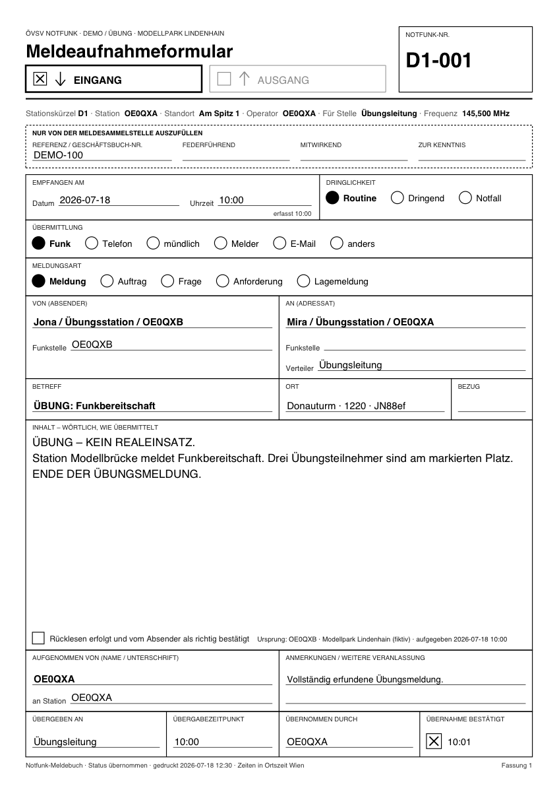

# Ausdruck und PDF

[← Notfunk-Anleitung](index.md) · [Notfunk-Meldebuch öffnen](../notfunk/index.html)
{ .doc-nav }

Das Meldebuch erzeugt **PDF-Dateien**: eine einzelne Meldung als Formular, das
leere Formular und das ganze Meldebuch. Gedruckt wird im Druckdialog des
PDF-Betrachters (Skalierung „Tatsächliche Größe“ bzw. 100 %).

## Das leere Formular für Papier

Für die Arbeit ohne Gerät gibt es das Meldeaufnahmeformular zum Ausdrucken
(A4 hoch, eine Seite). Es hat dieselben Felder wie das Formular im
Meldebuch; Wahlmöglichkeiten wie Dringlichkeit, Übermittlung und Meldungsart
kreuzen Sie an oder kreisen sie ein.

[Leeres Formular (PDF) herunterladen](../downloads/notfunk-vordruck.pdf){ download="notfunk-vordruck.pdf" }

Im Meldebuch finden Sie es auch auf der Startseite unter „Leeres Formular
(PDF)“ und unter „Drucken / PDF…“.

[{ .wide }](../img/notfunk-vordruck-beschriftet.png)

Ausfüllen auf Papier: Wortlaut ins große Feld, **zurücklesen** lassen und
abhaken, Übergabe bzw. Übertragung unten eintragen. Den Block „Nur von der
Meldesammelstelle auszufüllen“ lassen Sie frei.

## Eine Meldung als Formular

**„Ausdruck / PDF“** in der Meldung (oder „PDF“ in der Zeile des
Meldebuchs) schreibt die Meldung ins Formular und öffnet das PDF in einem
neuen Tab; blockiert der Browser den Tab, wird es heruntergeladen.

Auf dem Ausdruck stehen alle Angaben der Meldung und des Einsatzes, die
Richtung (die gewählte angekreuzt), Datum und Uhrzeit in Ortszeit Wien und
unten die Übergabe bzw. Übertragung. Eine sehr lange Meldung läuft auf
Folgeseiten weiter; es wird nichts abgeschnitten.

## Das Meldebuch als PDF

**„Drucken / PDF…“** im Meldebuch, optional mit Zeitraum (Von/Bis mit Datum
und Uhrzeit; nur ein Datum = der ganze Tag), dann **„Meldebuch als PDF“**.
Das PDF (A4 quer) hat die Spalten des Meldebuchs, den ganzen Inhalt jeder
Meldung und auf jeder Seite Einsatz, Zeitraum und „Seite n von N“. Notfall
und Dringend sind auch schwarzweiß gedruckt erkennbar.

Weiter: [Sicherung und Wiederherstellung](sicherung.md)
