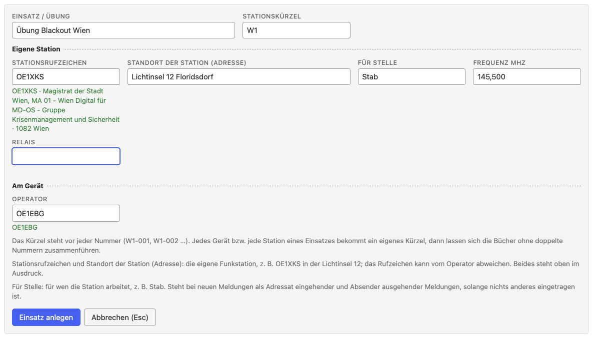

# Notfunk logbook: introduction and tutorial

[Open the Notfunk logbook →](../notfunk/index.html){ .tool-launch }
[All tools](../index.md) ·
[Deutsche Anleitung (full manual)](index.md) ·
[Empty form (PDF)](../downloads/notfunk-vordruck.pdf){ download="notfunk-vordruck.pdf" } ·
[Source code](https://github.com/oe1ebg/tools/tree/main/tools/notfunk)
{ .tool-actions }

The [Notfunk logbook](../notfunk/index.html) (*Notfunk-Meldebuch*) is a logbook
for emergency radio in Vienna, Austria: take down messages, number them
without gaps, hand them over, transmit them and print them. It runs entirely
in the browser, works offline, and keeps all data on the device. The tool
itself is in German; this page explains the idea and walks through an
example. The complete reference of every field and button is the
[German manual](index.md).

!!! warning "Draft"
    The message format has not yet been agreed with the Notfunkreferat Wien
    and the Meldesammelstelle. Fields, labels and urgency levels may change.
    Intended for exercises.

## Introduction: the path of an emergency message

### The situation

In a large-scale communication outage, such as a blackout, the usual ways
fail: calls to emergency numbers by phone or mobile no longer get through.
For this case the City of Vienna sets up **Lichtinseln** ("islands of
light"), places run by religious communities where citizens can get help
and information. They are equipped with radios and, where possible, staffed
by radio amateurs of the Notfunkreferat. A message from the neighbourhood
can thus reach the city's crisis management even when nothing else works
([sources](#sources)).

### The path of a message

Someone comes to the Lichtinsel with an emergency. Their message is
**taken down**, **relayed by radio**, **received** by the crisis staff and
decided on; the reply travels the same path **back**.

<figure class="diagram">
<svg viewBox="0 0 1048 430" role="img" aria-labelledby="nf-ablauf-t nf-ablauf-d" xmlns="http://www.w3.org/2000/svg" fill="currentColor" font-family="inherit" font-size="14">
<title id="nf-ablauf-t">Der Weg einer Notmeldung und der Rückweg der Antwort</title>
<desc id="nf-ablauf-d">Von links nach rechts: Hilfesuchende kommen zur Lichtinsel, wo ein Funkamateur die Meldung aufnimmt (ein Rücklesen wird empfohlen). Über das lokale Informationsnetz geht sie an den K-Vorsorgestandort, von dort über BOS-Funk oder das taktische Netz an die Funkstelle in der Einsatzleitstelle. Der Funkamateur dort übergibt sie an die Meldesammelstelle des Kriseneinsatzstabs; hier endet die Aufgabe der Funkamateure. Die Meldesammelstelle nennt eine Referenz. Die Antwort nimmt denselben Weg zurück bis zu den Hilfesuchenden.</desc>
<defs>
<marker id="nf-pfeil" viewBox="0 0 10 10" refX="9" refY="5" markerWidth="8" markerHeight="8" orient="auto-start-reverse"><path d="M0 0L10 5L0 10z" fill="currentColor"/></marker>
</defs>
<g font-size="13" text-anchor="middle" fill-opacity=".8">
<text x="195" y="60">mündlich,</text><text x="195" y="76">schriftlich</text>
<text x="409" y="60">Funk: lokales</text><text x="409" y="76">Informationsnetz</text>
<text x="623" y="44">BOS-Funk, Backup:</text><text x="623" y="60">taktisches Netz</text><text x="623" y="76">(Amateurfunk, DMR)</text>
<text x="837" y="60">Übergabe, Referenz</text><text x="837" y="76">(Papier, mündlich)</text>
</g>
<g stroke="currentColor" stroke-width="1.5" fill="none">
<rect x="10" y="100" width="172" height="170" rx="8" stroke-dasharray="6 5"/>
<rect x="224" y="100" width="172" height="170" rx="8" stroke-width="3" fill="currentColor" fill-opacity=".08"/>
<rect x="438" y="100" width="172" height="170" rx="8" stroke-width="3" fill="currentColor" fill-opacity=".08"/>
<rect x="652" y="100" width="172" height="170" rx="8" stroke-width="3" fill="currentColor" fill-opacity=".08"/>
<rect x="866" y="100" width="172" height="170" rx="8" stroke-dasharray="6 5"/>
</g>
<g text-anchor="middle">
<text x="96" y="132" font-weight="700" font-size="16">Hilfesuchende</text>
<text x="96" y="160">Bürgerinnen und Bürger</text>
<text x="96" y="182">kommen zur Lichtinsel</text>
<text x="96" y="236" font-size="13" fill-opacity=".8">kein Funkamateur</text>

<text x="310" y="132" font-weight="700" font-size="16">Lichtinsel</text>
<text x="310" y="160">Funkamateur</text>
<text x="310" y="182">nimmt den Wortlaut auf</text>
<text x="310" y="204">(Rücklesen empfohlen)</text>
<text x="310" y="236" font-size="13" fill-opacity=".8">Meldung ↑ Ausgang</text>

<text x="524" y="132" font-weight="700" font-size="16">K-Vorsorgestandort</text>
<text x="524" y="160">Leitstelle des lokalen</text>
<text x="524" y="182">Informationsnetzes</text>
<text x="524" y="204">gibt weiter</text>
<text x="524" y="236" font-size="13" fill-opacity=".8">Weitergabe ↓ ↑</text>

<text x="738" y="132" font-weight="700" font-size="16">Funkstelle der ELS</text>
<text x="738" y="160">Funkamateur nimmt auf,</text>
<text x="738" y="182">übergibt an die</text>
<text x="738" y="204">Meldesammelstelle</text>
<text x="738" y="236" font-size="13" fill-opacity=".8">Meldung ↓ Eingang</text>

<text x="952" y="132" font-weight="700" font-size="16">Meldesammelstelle</text>
<text x="952" y="160">des Kriseneinsatzstabs</text>
<text x="952" y="182">vergibt die Referenz,</text>
<text x="952" y="204">der Stab entscheidet</text>
<text x="952" y="236" font-size="13" fill-opacity=".8">kein Funkamateur</text>
</g>
<g stroke="currentColor" stroke-width="2.5" fill="none">
<path d="M186 160H220" marker-end="url(#nf-pfeil)"/>
<path d="M400 160H434" marker-end="url(#nf-pfeil)"/>
<path d="M614 160H648" marker-end="url(#nf-pfeil)"/>
<path d="M828 160H862" marker-end="url(#nf-pfeil)"/>
<g stroke-dasharray="7 4">
<path d="M862 220H828" marker-end="url(#nf-pfeil)"/>
<path d="M648 220H614" marker-end="url(#nf-pfeil)"/>
<path d="M434 220H400" marker-end="url(#nf-pfeil)"/>
<path d="M220 220H186" marker-end="url(#nf-pfeil)"/>
</g>
</g>
<g text-anchor="middle" font-size="13" font-weight="700">
<g stroke="currentColor" stroke-width="3" fill="none"><circle cx="203" cy="140" r="11"/><circle cx="417" cy="140" r="11"/><circle cx="631" cy="140" r="11"/><circle cx="845" cy="140" r="11"/></g>
<g stroke="currentColor" stroke-width="2" fill="none"><circle cx="845" cy="240" r="11"/><circle cx="631" cy="240" r="11"/><circle cx="417" cy="240" r="11"/><circle cx="203" cy="240" r="11"/></g>
<text x="203" y="145">1</text><text x="417" y="145">2</text><text x="631" y="145">3</text><text x="845" y="145">4</text>
<text x="845" y="245">5</text><text x="631" y="245">6</text><text x="417" y="245">7</text><text x="203" y="245">8</text>
</g>
<g stroke="currentColor" stroke-width="2" fill="none">
<path d="M224 296V306H824V296"/>
</g>
<text x="524" y="328" text-anchor="middle" font-weight="700">Hier arbeiten Funkamateure: sie übermitteln, was aufgenommen wurde –</text>
<text x="524" y="348" text-anchor="middle" font-weight="700">wörtlich, ohne Zusatz, ohne eigene Bewertung.</text>
<g font-size="13">
<path d="M10 396H60" stroke="currentColor" stroke-width="2.5" marker-end="url(#nf-pfeil)"/>
<text x="68" y="401">1 – 4 Meldung (hin)</text>
<path d="M300 396H350" stroke="currentColor" stroke-width="2.5" stroke-dasharray="7 4" marker-end="url(#nf-pfeil)"/>
<text x="358" y="401">5 – 8 Rückmeldung (zurück), z. B. „Hilfe ist unterwegs“</text>
</g>
</svg>
<figcaption>The path of an emergency message (1 to 4) and of the reply (5 to 8). Bold outline: radio amateurs work here. Labels in German as in the tool.</figcaption>
</figure>

**Forward:**

1. **Take down.** A person describes the emergency. The radio amateur at
   the Lichtinsel writes down the exact wording. For safety they read it back
   and the person confirms it is right (recommended, not mandatory).
2. **Transmit.** The message goes over the local information network to the
   responsible K-Vorsorgestandort (a district support site). Reading back by the receiver is recommended, but not
   mandatory. If the Lichtinsel is not checked in to a local
   network, it goes over the Informationsnetz Wien.
3. **Relay.** The K-Vorsorgestandort passes it to the Einsatzleitstelle
   (ELS, the operations centre of the crisis management), normally over
   authorities' radio (BOS-Funk), with the tactical amateur radio network as
   backup. There the amateur station (OE1XKS while the ELS works at its usual
   place; otherwise another callsign) takes it down.
4. **Hand over.** The radio amateur in the ELS hands the message to the
   **Meldesammelstelle** (message collection point). It belongs to the
   **Kriseneinsatzstab** (crisis staff), not to amateur radio. This is where
   the radio amateurs' job ends: what the staff does with the message is
   their decision. The Meldesammelstelle enters it in its registry and gives a
   **reference**; the radio amateur records it in the logbook.

**Back:**

5. The staff decides and replies through the Meldesammelstelle, for example "Tanker with 200 litres of
   diesel is on its way, arrival about 15:30."
6. The Meldesammelstelle gives the reply to the radio amateur in the ELS,
   who takes it down word for word, transmits it to the K-Vorsorgestandort.
7. The K-Vorsorgestandort passes it on to the Lichtinsel.
8. The radio amateur at the Lichtinsel takes it down and
   **tells the person who reported the emergency**: "Help is on its way."

Two kinds of feedback differ:

- The **takeover** ("message received, reference GZ 0412") only confirms the
  message is with the Meldesammelstelle. It comes quickly and says nothing about help.
- The **reply** ("help is on its way") comes when the staff has decided. It
  is a message of its own that refers to the original.

Which stations a message actually passes depends on the situation; the
picture shows the regular path of the *Richtlinie Notfunk Teil 2 – Wien*
([sources](#sources)).

### What radio amateurs do, and what they don't

In this chain radio amateurs are **messengers**, nothing more. The guideline
says: amateur stations should not create messages themselves, only transmit
them.

**Radio amateurs …**

- take down the **exact wording** as given,
- read back where possible, so nothing arrives wrong,
- transmit the message and pass on the reply word for word,
- record **handover and receipt**.

**Radio amateurs do not …**

- interpret, add to, shorten or "improve" the content,
- pass on guesses or unverified information,
- arrange or promise help themselves.

**Every message that is transmitted belongs in the logbook**, as it actually
went: with wording, times, handovers and replies. The message flow should be
traceable without gaps, as far as possible. If there is no time right now,
write on paper and enter the message afterwards ("Nachtrag vom Papier").

The logbook helps: the wording is stored unchanged, numbers are gapless,
every version is kept, and it shows who handed over what and when.

### Where the logbook fits in

Every station keeps a logbook and every message gets a number. A message's
progress is its status:

| Station | Direction | Status in the logbook |
| --- | --- | --- |
| Lichtinsel, message to the staff | ↑ Ausgang (outgoing) | zur Übertragung → übertragen → Empfang bestätigt → beantwortet |
| Lichtinsel, reply from the staff | ↓ Eingang (incoming) | erfasst → übergeben (to the person) → übernommen |
| Station in the ELS, message from the Lichtinsel | ↓ Eingang | erfasst → übergeben (to the Meldesammelstelle) → übernommen (with the **reference**) → beantwortet |
| Station in the ELS, reply from the staff | ↑ Ausgang | zur Übertragung → übertragen → Empfang bestätigt |

The **Notfunk number** (`W1-007`) belongs to the station, the **reference**
to the staff's own registry (*Geschäftsbuch*). The logbook keeps both apart
so the two lists can be matched.

The logbook is built to run reliably offline. Even so, be prepared for
**paper-only** operation in case the device or the power fails: **print the
paper forms in advance** and keep a stack ready (German form below). Enter the
messages in the logbook afterwards.
[Download the empty form (PDF)](../downloads/notfunk-vordruck.pdf){ download="notfunk-vordruck.pdf" }
(German; the same form the tool prints). Personal data must be deleted when
no longer needed; the logbook never deletes by itself, so you manage
operations and backups yourself.

## Tutorial: a message from the Lichtinsel to the staff

The example: exercise "Blackout Wien". You are a radio amateur at the
Lichtinsel Floridsdorf. Ms Huber, head of nursing at a care home at
Brünner Straße 68, arrives on foot: the emergency generator only runs until
about 18:00, and 6 ventilated residents are at risk. They need diesel.
Callsigns and names are made up.

### 1. Prepare

1. [Open the logbook](../notfunk/index.html) once with internet and install it
   as an app (browser menu: "Install app" / "Add to Home Screen"); afterwards
   it works offline ("offline bereit ✓" top right). For laptops without
   internet there is a single offline HTML file to carry on a USB stick.
2. **"+ Neuer Einsatz"** (new operation): operation name, station prefix
   **W1**, your station callsign, location, operator, "Für Stelle" **Stab**
   and the frequency of the local network. Then "Einsatz anlegen".

    

   The prefix stands before every number. If the Lichtinsel has two
   devices, each gets its own prefix (W1, W2) so numbers never collide.

### 2. Take down the message

You transmit the message, so the direction is **Ausgang (↑)**.

1. **Richtung:** Ausgang. **Übermittlung:** Funk. **Funkstelle:** the
   callsign of the station you transmit to (OE1DEF, the K-Vorsorgestandort).
2. **Von:** "Pflegeheim Brünner Straße 68, Frau Huber"; **An:** "Stab". The
   sender is the person, not you.
3. **Dringlichkeit:** "Dringend" (to be transmitted before routine);
   "Notfall" is for immediate danger to life. When in doubt, ask the control
   station.
4. **Betreff** (subject) and **Ort** (location; the address search suggests
   matches offline).
5. **Inhalt – wörtlich:** the exact wording.
6. **Rücklesen** (recommended, not mandatory): read the message back to the
   person; when they say "right", tick the box, otherwise leave it empty.

    

7. **Save** with <kbd>⇧</kbd>+<kbd>Enter</kbd>. Only now the number is
   assigned: **W1-001**.

### 3. Transmit and record it

1. In the message's row click **"übertragen"** and enter who you transmitted
   to (time empty = now).
2. When the other station has confirmed receipt (and read back, if you did), enter **"Empfang
   bestätigt"**.
3. When the Meldesammelstelle reports a **reference** ("GZ 0412"), enter it.

    

### 4. Receive the reply

1. Open W1-001 and choose **"Antwort erfassen"**: the form opens as
   **Eingang** with sender and addressee swapped and the reference set.
2. Enter the exact wording of the reply, read it back, save (**W1-002**).
   W1-001 is now **beantwortet**.
3. Tell Ms Huber, and record that you passed it on.

    

### 5. At the end

Download a **backup (JSON)** (the status top right counts messages not yet
backed up), and print messages or the whole logbook as PDF. Details are in
the [German manual](index.md).

## Sources

The introduction rests on these documents; they apply, not this page.

- **Richtlinie Notfunk, Teil 2 – Wien**, edition 1.0 of 2024-10-20,
  Notfunkreferat of the Landesverband Wien of the ÖVSV:
  [Richtlinie-NF-Wien-1_0.pdf](https://oe1.oevsv.at/export/sites/oe1/not-und-katastrophenfunk/doc/Richtlinie-NF-Wien-1_0.pdf)
  (network structure, message handling, operating technique, frequencies,
  documentation, data protection).
- **ÖVSV Landesverband Wien (OE1):** [oe1.oevsv.at](https://oe1.oevsv.at/).
- **ÖVSV wiki, category Notfunk:**
  [wiki.oevsv.at/wiki/Kategorie:NOTFUNK](https://wiki.oevsv.at/wiki/Kategorie:NOTFUNK).
- **SKKM-Richtlinie für das Führen im Katastropheneinsatz** (Federal Ministry
  of the Interior):
  [PDF](https://www.bmi.gv.at/204/download/files/skkm-richtlinie-fuer-das-fuehren-im-katastropheneinsatz_bf_20260820.pdf).
- **ÖBFV Info E-31** (2022):
  [PDF](https://www.bundesfeuerwehrverband.at/wp-content/uploads/2022/12/E-31-Info_2022.pdf).
- **Lichtinseln of the City of Vienna:**
  [ORF Wien](https://wien.orf.at/stories/3253406/),
  [Erzdiözese Wien](https://erzdioezese-wien.at/site/home/nachrichten/article/128073.html)
  (background).
- **Legal basis named by the guideline:** Datenschutzgesetz § 10 in the
  [Rechtsinformationssystem](https://www.ris.bka.gv.at/); [W-KKG, LGBl.
  60/2003](https://www.gemeinderecht.wien.at/recht/landesrecht-wien/landesgesetzblatt/jahrgang/2003/pdf/lg2003060.pdf).

---

[Open the Notfunk logbook →](../notfunk/index.html){ .tool-launch }
{ .tool-actions }
