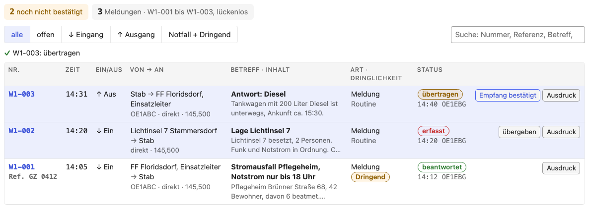
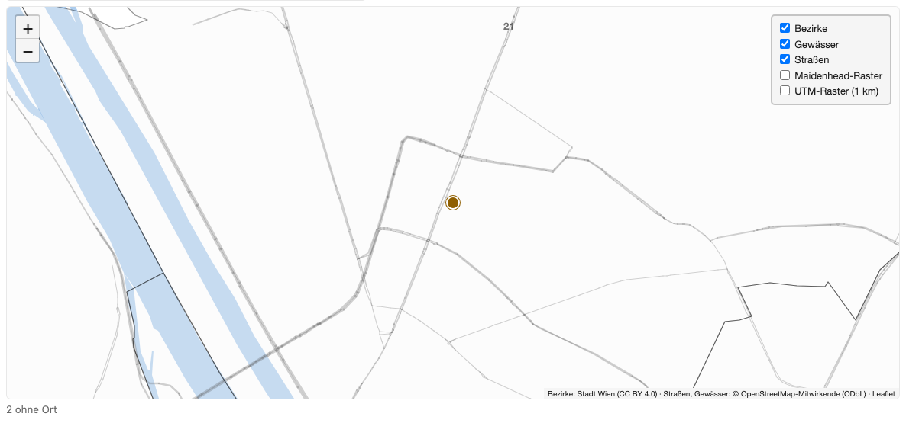
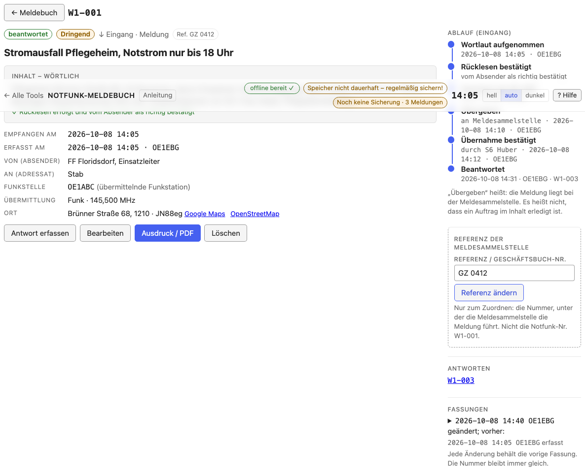

# Das Meldebuch

[← Notfunk-Anleitung](../index.de.md) · [Notfunk-Meldebuch öffnen](../../notfunk/index.html)
{ .doc-nav }

Das Meldebuch zeigt alle Meldungen eines Einsatzes, die neuesten zuerst.
Oben steht die Zusammenfassung: offene Notfälle, noch nicht bestätigte
Meldungen, die Nummern und ob sie lückenlos sind. Mit den Filtern (alle,
offen, Eingang, Ausgang, Notfall + Dringend) und der Suche (Nummer, Referenz,
Betreff, Station, Text) finden Sie eine Meldung schnell.

## Eine Zeile lesen

- **Nr. · Zeit:** die Notfunk-Nummer, darunter die Zeit (Ortszeit Wien), die
  Referenz der Meldesammelstelle und bei einer Antwort „↪“ mit der Nummer der
  Meldung, auf die sie antwortet.
- **Gegenstelle:** die andere Seite, mit **↓** (Eingang: von ihr) oder **↑**
  (Ausgang: an sie).
- **Betreff · Inhalt:** Meldungsart, Dringlichkeit (rot Notfall, gelb
  Dringend), Betreff und der Anfang des Inhalts.
- **Status:** der Stand der Meldung, mit Zeit und Operator des letzten
  Schritts.
- Ganz rechts der **nächste Schritt** und **PDF** (die Meldung als Formular).

Am Handy ist jede Meldung eine Karte mit denselben Angaben.

## Der Status

Der Status hängt von der Richtung ab:

| Richtung | 1 | 2 | 3 | danach |
| --- | --- | --- | --- | --- |
| ↓ Eingang | erfasst | übergeben | übernommen | beantwortet |
| ↑ Ausgang | zur Übertragung | übertragen | Empfang bestätigt | beantwortet |

Der Knopf in der Zeile („übergeben“, „Übernahme bestätigt“, „übertragen“,
„Empfang bestätigt“) öffnet ein kleines Fenster für diesen Schritt: **an wen**
bzw. **durch wen**, der **Zeitpunkt** (leer = jetzt) und bei „Übernahme
bestätigt“ die **Referenz der Meldesammelstelle**, wenn sie genannt wird.
<kbd>Enter</kbd> trägt ein, <kbd>Esc</kbd> schließt ohne Eintrag.

„Beantwortet“ entsteht von selbst, sobald eine Antwort mit Bezug auf die
Meldung gespeichert wird.

## Die Karte

*Im Bild der Beispiel-Einsatz zum Ausprobieren
([notfunk-full.json](https://github.com/oe1ebg/tools/blob/main/examples/backups/notfunk-full.json),
über „Wiederherstellen…“ einspielen).*

„Karte“ (neben der Suche) zeigt die Meldungen der aktuellen Auswahl an ihrem
Ort, auf einer Wien-Karte, die auch ohne Internet funktioniert. Die Farbe
eines Punkts ist die höchste Dringlichkeit: rot Notfall, gelb Dringend, blau
Routine. Eine Zahl auf dem Punkt heißt: mehrere Meldungen am selben Ort. Mit
der Maus darüber (am Handy: antippen) sehen Sie Nummer, Zeit, Betreff und
Status; die Nummer führt zur Meldung. Der Stern ist der Standort Ihrer
Station. Unter der Karte steht, welche Meldungen keinen Ort haben.

## Eine Meldung im Detail

Ein Klick auf die Zeile (oder die Nummer) öffnet die Meldung: oben Status,
Art, Richtung und Zeit, dann **Von → An**, der **Wortlaut**, darunter
Übermittlung, Ort (mit kleiner Karte), Ursprung und Anmerkungen. Rechts steht
der **Ablauf**: wann und von wem die Meldung erfasst, übergeben bzw.
übertragen und bestätigt wurde.

- **Eingang:** „Übergeben an“ (z. B. die Meldesammelstelle), dann „Übernommen
  durch“ und, wenn genannt, die Referenz der Meldesammelstelle.
- **Ausgang:** „Übertragen an“ (die Funkstelle), ggf. ob sie zurückgelesen hat,
  dann „Empfang bestätigt durch“. Klappt eine Übertragung nicht oder gibt es
  eine Rückfrage: „Fehlversuch / Rückfrage eintragen“.
- Zeitpunkt leer = jetzt; sonst die Uhrzeit, z. B. `14:10`.

**Referenz der Meldesammelstelle:** die Nummer, unter der die
Meldesammelstelle die Meldung in ihrem Geschäftsbuch führt. Tragen Sie sie
ein, sobald sie zurückgemeldet wird; so lassen sich die beiden Listen
zuordnen. Die Notfunk-Nummer (`W1-007`) ist **nicht** die
Geschäftsbuchnummer.

Weitere Knöpfe bei der Meldung:

- **Antwort erfassen:** Richtung, Absender und Adressat sind vertauscht, der
  Bezug ist gesetzt.
- **Bearbeiten:** korrigiert die Meldung; die vorige Fassung bleibt
  gespeichert.
- **Ausdruck / PDF:** siehe [Ausdruck und PDF](printout.de.md).
- **Löschen:** die Meldung verschwindet aus der Liste, ihre Nummer bleibt
  vergeben und wird nie wieder verwendet. Unter „Gelöschte Meldungen“ lässt
  sie sich wiederherstellen.

Weiter: [Ausdruck und PDF](printout.de.md)
