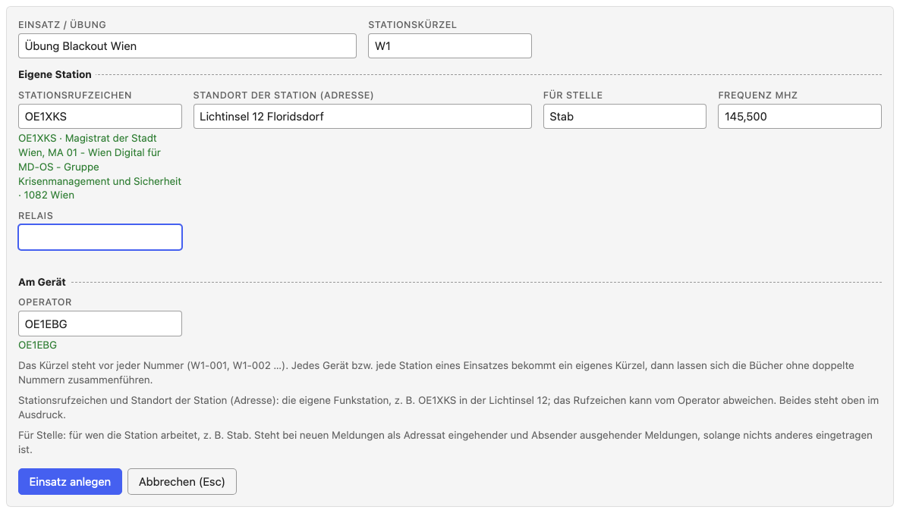

# Einen Einsatz anlegen

[← Notfunk-Anleitung](../index.de.md) · [Notfunk-Meldebuch öffnen](../../notfunk/index.html)
{ .doc-nav }

Ein **Einsatz** (oder eine Übung) ist ein eigenes Meldebuch mit eigener
Nummerierung. Legen Sie ihn mit **„+ Neuer Einsatz“** an.

| Feld | Bedeutung | Beispiel |
| --- | --- | --- |
| Einsatz / Übung | Name des Einsatzes | Übung Blackout Wien |
| Stationskürzel | steht vor jeder Nummer; jedes Gerät eines Einsatzes bekommt ein eigenes | W1 |
| Übung | Kästchen: der Einsatz ist eine Übung (siehe unten) | angekreuzt |
| **Eigene Station:** | | |
| Stationsrufzeichen | Rufzeichen Ihrer Funkstation, kann vom Rufzeichen des Operators abweichen | OE1ABC |
| Standort der Station (Adresse) | wo Ihr Funkgerät steht; steht oben im Ausdruck | Lichtinsel 12 Floridsdorf |
| Für Stelle | für wen die Station arbeitet: Adressat eingehender und Absender ausgehender Meldungen | Stab |
| Frequenz, Relais | Vorgabe für neue Meldungen; Relais leer = direkt | 438,950 |
| **Am Gerät:** | | |
| Operator | wer am Gerät aufnimmt | OE1EBG |

Stationsrufzeichen und Operator werden bei jeder Meldung mitgespeichert und
stehen im Ausdruck („Aufgenommen von OE1EBG, an Station OE1ABC“).

## Übung

Bei einer Übung wird jede Meldung am Funk mit **„ACHTUNG ÜBUNG“** eingeleitet
und beendet. Setzen Sie dafür beim Anlegen das Kästchen **„Übung“**. Dann

- steht oben in der Kopfzeile **„ÜBUNG“**, solange der Einsatz offen ist,
- erinnert unter dem Inhalt der Hinweis **„Vor und nach dem Spruch:
  „ACHTUNG ÜBUNG““**,
- tragen die Ausdrucke (Meldung, Meldebuch, leeres Formular) oben und in der
  Fußzeile „ÜBUNG“, und das Geschäftsbuch (CSV) hat am Ende die Spalte
  „Übung“ mit „ja“.

Das Meldebuch fügt „ACHTUNG ÜBUNG“ **nicht** in den Inhalt ein: gespeichert
wird der Wortlaut, wie Sie ihn eintippen. Einsätze, die vor dieser Funktion
angelegt wurden, gelten als keine Übung; das Kästchen lässt sich jederzeit
im Feld „Einsatz“ setzen oder löschen.

## Später ändern

Alles außer dem Stationskürzel lässt sich im aufklappbaren Feld **„Einsatz“**
über dem Formular ändern; Änderungen gelten für neue Meldungen. Das
Kästchen „Übung“ gilt für den ganzen Einsatz, auch für Ausdrucke älterer
Meldungen. Das Stationskürzel bleibt fest, sobald die erste Meldung
gespeichert ist.

**Schichtwechsel:** im Feld „Einsatz“ den Operator ändern (oder oben im
Formular auf „Aufnahme OE1EBG“ klicken). Gespeicherte Meldungen behalten den
Operator, der sie aufgenommen hat.

<kbd>Esc</kbd> setzt ein Feld auf den Wert zurück, den es vor dem Bearbeiten
hatte; „Rückgängig“ stellt den Einsatz wieder her, wie er beim Öffnen des
Feldes war.

Weiter: [Eine Meldung aufnehmen](message.de.md)
