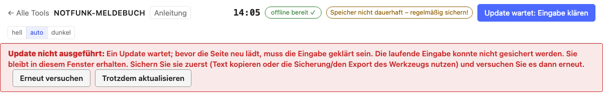

# Vorbereitung

[← Notfunk-Anleitung](../index.de.md) · [Notfunk-Meldebuch öffnen](../../notfunk/index.html)
{ .doc-nav }

Was Sie vor einem Einsatz oder einer Übung erledigen sollten.

## Offline verwenden

Das Meldebuch muss im Einsatz ohne Internet laufen. Es gibt zwei empfohlene
Wege; richten Sie einen davon **vor** dem Einsatz ein und probieren Sie ihn
aus.

!!! warning "Nur die Adresse im Browser öffnen genügt nicht"
    Auch wenn das Meldebuch einmal geladen wurde, kann der Browser es ohne
    Verbindung nicht immer wieder öffnen, zum Beispiel nach einem Neustart
    des Geräts oder wenn der Browser Speicher aufräumt. Installieren Sie es
    deshalb als App oder nehmen Sie die Offline-Datei.

### Weg 1: als App installieren (empfohlen)

Die installierte App liegt wie jedes andere Programm auf dem Gerät, mit
eigenem Symbol und eigenem Fenster, und läuft ohne Internet. Dafür öffnen
Sie das Meldebuch **einmal mit Internet**:

1. Öffnen Sie das [Notfunk-Meldebuch](../../notfunk/index.html) im Browser und
   warten Sie, bis oben rechts **„offline bereit ✓“** steht. Dabei lädt es
   alles, was es braucht (Rufzeichenliste, Relaisliste, Wiener Adressen).
2. Installieren Sie es:
    - **Computer mit Chrome oder Edge:** das Installieren-Symbol rechts in der
      Adresszeile anklicken (oder Menü ⋮ → „Notfunk-Meldebuch installieren“).
      Die App bekommt ein Symbol auf dem Desktop bzw. im Startmenü.
    - **Android (Chrome):** Menü ⋮ → „App installieren“ bzw. „Zum
      Startbildschirm hinzufügen“.
    - **iPhone und iPad (Safari):** Teilen-Symbol → „Zum Home-Bildschirm“.
    - **Mac (Safari):** Ablage → „Zum Dock hinzufügen“.
    - **Firefox am Computer** kann Web-Apps meist nicht installieren; nehmen
      Sie dort die Offline-Datei oder Chrome bzw. Edge.
3. Starten Sie die App über ihr Symbol.
4. **Probe:** Schalten Sie das Netz ab (Flugmodus, WLAN aus) und starten Sie
   die App neu. Sie muss sich öffnen und „offline bereit ✓“ zeigen.

Steht oben „offline nicht bereit“, hat der Browser die Offline-Kopie
gelöscht: Öffnen Sie die App einmal mit Internet; sie richtet sich dann von
selbst wieder ein.

### Weg 2: die Offline-Datei für den USB-Stick

Für Laptops ohne Internet, oder als zweite Absicherung, gibt es die
**Offline-Datei**: eine einzelne HTML-Datei (etwa 7 MB), die alles enthält.
Sie finden sie unten auf der Startseite des Werkzeugs oder hier:
[Offline-Datei herunterladen](../../notfunk/notfunk-offline.html){ download="notfunk-meldebuch-offline.html" }.
Kopieren Sie sie auf einen USB-Stick oder das Gerät
und öffnen Sie sie mit einem Doppelklick im Browser; es braucht keine
Installation und kein Internet.

- Die Offline-Datei und die installierte App haben **getrennte Daten**.
  Entscheiden Sie sich in einem Einsatz für **eine** davon; zum Umziehen
  verwenden Sie die [Sicherung](backup.de.md).

## Ortslisten: Lichtinseln und andere eigene Orte

In Meldungen heißen Orte oft nur beim Namen: eine Lichtinsel, ein
K-Vorsorgestandort, eine Verbindungsstation. Damit das Meldebuch diese Namen
kennt, laden Sie **vor dem Einsatz** eine eigene Ortsliste. Das Werkzeug
selbst enthält keine solchen Orte; Ihre Liste bleibt auf diesem Gerät und wird
nirgends hingeschickt.

Die Ortsliste ist eine CSV-Datei (Excel, LibreOffice oder ein Texteditor).
Die erste Zeile benennt die Spalten, jede weitere ist ein Ort:

```
Name;Typ;Adresse;Breite;Länge;Aliase
Lichtinsel Musterpark;Lichtinsel;Mustergasse 1, 1210 Wien;48,2701;16,4012;LI Musterpark|Musterpark
```

1. Legen Sie die Datei an:
    - **Name**, **Breite** und **Länge** sind Pflicht; Breite und Länge in Grad
      (WGS84, wie in einer Karten-App), mit Komma oder Punkt.
    - **Typ**, **Adresse** und **Aliase** sind freiwillig. Aliase sind andere
      Namen desselben Orts, getrennt durch `|`.
    - Getrennt wird mit Strichpunkt oder Komma. Die Datei darf UTF-8 sein oder
      so, wie Excel sie als „CSV (Trennzeichen-getrennt)“ speichert.
2. Unten auf der Seite: **„Ortslisten … verwalten…“** → **„Liste
   hinzufügen…“** und die Datei wählen. Das Meldebuch nennt Zeilen, die es
   überspringt (ohne Name, ohne gültige Koordinaten, Breite und Länge
   vertauscht), mit ihrer Zeilennummer.
3. **Probe:** Im Dialog unter „Ort suchen“ einen Namen oder Alias eintippen.

Im Einsatz schlagen **Ort**, **Ursprungsort** und **Standort der Station**
die passenden Orte mit ihrer Adresse vor; ein genau getippter Name oder Alias
wird automatisch zugeordnet. So steht die Meldung auf der Karte.

- **Ersetzen…** liest eine neue Fassung der Liste ein; **Rückgängig** holt die
  vorige zurück. **Exportieren** speichert die Liste wieder als CSV.
  **Löschen** blendet sie aus und lässt sich wiederherstellen; erst
  **Endgültig löschen** entfernt sie vom Gerät.
- Höchstens 2 MB und 10.000 Orte je Datei, 50.000 Orte insgesamt; eine
  größere Datei wird abgelehnt, ohne etwas zu ändern.
- Die Ortslisten gelten für alle Werkzeuge auf diesem Gerät, sind aber
  **nicht in der Sicherung** enthalten: Bewahren Sie die CSV-Datei auf. Die
  Offline-Datei hat ihren eigenen Speicher; laden Sie die Liste dort
  ebenfalls.
- Bereits gespeicherte Meldungen behalten den Ort, den sie beim Speichern
  hatten.

## Papier als Rückfall

Auch das beste Gerät kann ausfallen. Drucken Sie vor dem Einsatz das
[leere Formular](printout.de.md#das-leere-formular-fur-papier) aus und halten Sie
einen Stapel bereit (zusammen mit Stift und Notizpapier); [hier
herunterladen](../../downloads/notfunk-vordruck.pdf){ download="notfunk-vordruck.pdf" }.

## Daten sichern

Alle Meldungen liegen nur auf diesem Gerät. Sichern Sie deshalb regelmäßig.

- Oben rechts steht der **Sicherungsstand**, zum Beispiel „Sicherung
  gestartet 14:40 · 3 Meldungen ungesichert“. Ein Klick darauf lädt eine
  Sicherungsdatei herunter.
- „Gestartet“ heißt: Der Download hat begonnen. Prüfen Sie, dass die Datei
  im Download-Ordner liegt, und kopieren Sie sie an einen sicheren Ort (USB-Stick,
  anderer Rechner).
- Steht oben **„Speicher dauerhaft ✓“**, löscht der Browser die Daten nicht von
  selbst. Steht dort „nicht dauerhaft“, sichern Sie besonders oft.

Mehr dazu: [Sicherung und Wiederherstellung](backup.de.md).

## Neue Version

Gibt es eine neue Version des Meldebuchs, erscheint oben der Balken **„Neue
Version bereit“**. Sie wird erst verwendet, wenn Sie **„Jetzt verwenden“**
klicken; mit „Später“ schließen Sie den Balken.

- Das Meldebuch wird dabei neu geladen, in **allen** offenen Fenstern.
  Gespeicherte Meldungen und Nummern bleiben unverändert, eine halb
  ausgefüllte Meldung wird gesichert und danach wieder eingesetzt.
- Speichern Sie vorher fertige Meldungen. Mitten im Einsatz aktualisieren Sie
  besser erst in einer ruhigen Phase.
- Steht auf dem Knopf **„Update wartet: Eingabe klären“**, konnte das
  Meldebuch Ihre halb fertige Eingabe nicht sicher sichern und lädt deshalb
  nicht neu. Eine rote Meldung unter der Kopfzeile sagt, was zu tun ist; sie
  bietet die möglichen Schritte gleich als Knöpfe an.



Weiter: [Einen Einsatz anlegen](operation.de.md)
