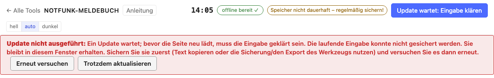

# Preparation

[← Notfunk logbook (English)](../index.en.md) · [Open the Notfunk logbook](../../notfunk/index.html)
{ .doc-nav }

What to do before an operation or an exercise. The tool itself is in German,
so buttons and messages are quoted in German with a translation.

## Using it offline

The logbook has to run without internet during an operation. There are two
recommended ways; set up one of them **before** the operation and try it out.

!!! warning "Just opening the address in the browser is not enough"
    Even after the logbook has been loaded once, the browser cannot always
    open it again without a connection, for example after the device
    restarts or when the browser cleans up storage. So install it as an app
    or use the offline file.

### Way 1: install it as an app (recommended)

The installed app sits on the device like any other program, with its own
icon and its own window, and runs without internet. To get it, open the
logbook **once with internet**:

1. Open the [Notfunk logbook](../../notfunk/index.html) in the browser and
   wait until **"offline bereit ✓"** (offline ready) appears at the top right.
   While doing so it loads everything it needs (callsign list, relay list,
   Vienna addresses).
2. Install it:
    - **Computer with Chrome or Edge:** click the install icon at the right
      of the address bar (or menu ⋮ → "Install Notfunk-Meldebuch"). The app
      gets an icon on the desktop or in the start menu.
    - **Android (Chrome):** menu ⋮ → "Install app" or "Add to Home screen".
    - **iPhone and iPad (Safari):** Share icon → "Add to Home Screen".
    - **Mac (Safari):** File → "Add to Dock".
    - **Firefox on a computer** usually cannot install web apps; use the
      offline file there, or Chrome or Edge.
3. Start the app from its icon.
4. **Test:** switch the network off (airplane mode, Wi-Fi off) and restart
   the app. It must open and show "offline bereit ✓".

If the top shows "offline nicht bereit" (not offline ready), the browser has
deleted the offline copy: open the app once with internet and it sets itself
up again.

### Way 2: the offline file for a USB stick

For laptops without internet, or as a second safeguard, there is the
**offline file**: a single HTML file (about 7 MB) that contains everything.
You find it at the bottom of the tool's start page or here:
[download the offline file](../../notfunk/notfunk-offline.html){ download="notfunk-meldebuch-offline.html" }.
Copy it to a USB stick or the device and open it with a double click in the
browser; it needs no installation and no internet.

- The offline file and the installed app have **separate data**. Decide on
  **one** of them for an operation; to move data across, use the
  [backup](backup.en.md).

## Paper as a fallback

Even the best device can fail. Before the operation, print the
[empty form](printout.en.md#the-empty-form-for-paper) and keep a stack ready
(together with a pen and note paper); [download it
here](../../downloads/notfunk-vordruck.pdf){ download="notfunk-vordruck.pdf" }.

## Backing up data

All messages are stored on this device only. So back up regularly.

- The **backup status** is at the top right, for example "Sicherung gestartet
  14:40 · 3 Meldungen ungesichert" (backup started 14:40, 3 messages not
  backed up). Clicking it downloads a backup file.
- "Started" means the download has begun. Check that the file is in the
  downloads folder and copy it to a safe place (USB stick, another computer).
- If the top shows **"Speicher dauerhaft ✓"** (storage persistent), the
  browser will not delete the data by itself. If it says "nicht dauerhaft",
  back up especially often.

More: [Backup and restore](backup.en.md).

## New version

When a new version of the logbook is available, the bar **"Neue Version
bereit"** (new version ready) appears at the top. It is only used once you
click **"Jetzt verwenden"** (use now); "Später" (later) closes the bar.

- The logbook then reloads, in **all** open windows. Saved messages and
  numbers stay unchanged; a half-filled message is saved and put back
  afterwards.
- Save finished messages first. In the middle of an operation, better update
  in a quiet phase.
- If the button says **"Update wartet: Eingabe klären"** (update waiting:
  sort out the input), the logbook could not safely back up your half-finished
  input and therefore does not reload. A red message under the header says
  what to do; it offers the possible steps as buttons.

Next: [Creating an operation](operation.en.md)
