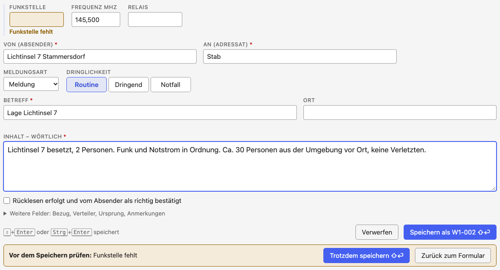

# Eine Meldung aufnehmen

[← Notfunk-Anleitung](index.md) · [Notfunk-Meldebuch öffnen](../notfunk/index.html)
{ .doc-nav }

Das Formular steht im Meldebuch ganz oben. Die nächste Nummer wird angezeigt
(„→ W1-008“), aber erst beim Speichern vergeben.

## Der Ablauf einer Meldung

1. **Wortlaut aufnehmen:** den Inhalt wörtlich, wie übermittelt.
2. **Rücklesen** (empfohlen, nicht zwingend): die Meldung dem Absender
   vorlesen bzw. von der Funkstelle zurücklesen lassen. Bestätigt er, setzen
   Sie das Häkchen „Rücklesen“; sonst lassen Sie es leer.
3. **Meldung sichern:** Speichern vergibt die Notfunk-Nummer.
4. **Übergabe bzw. Übertragung eintragen:** bei einer eingegangenen Meldung
   „übergeben“, bei einer ausgehenden „übertragen“, danach die Bestätigung.
5. **Referenz ergänzen:** die Nummer, die die Meldesammelstelle zurückmeldet.

„Übergeben“ oder „übertragen“ heißt nie, dass ein Auftrag im Inhalt erledigt
ist.

[{ .wide }](../img/notfunk-formular-beschriftet.png)

Jedes Feld ist im Bild beschriftet; die Farben zeigen, was zusammengehört. Wenn Sie die Meldung **empfangen** haben, wählen Sie „Eingang“; wenn Sie sie
**weiterfunken**, „Ausgang“. Zeiten und Daten geben Sie so ein, wie sie
angezeigt werden (`2026-10-08`, `14:05`); `20261008` und `1405` gehen auch.
Alle Zeiten sind **Ortszeit**, in 24-Stunden-Schreibweise.

**Pflichtfelder** sind mit \* markiert: Empfangen/Gesendet am, Von, An, Betreff
und Inhalt. Fehlt eines, steht der Hinweis direkt am Feld, und der Cursor
springt dorthin.

Unter **„Weitere Felder“** stehen:

| Feld | Bedeutung | Beispiel |
| --- | --- | --- |
| Bezug | Antwort, Korrektur oder Ergänzung zu einer anderen Meldung, mit deren Nummer | Antwort auf W1-003 |
| Verteiler | wer die Meldung noch bekommt | S3, S4 |
| Ursprungsstation | Station, bei der die Meldung ursprünglich aufgegeben wurde (bei Weitergaben) | OE3XYZ |
| Ursprungsort | Ort der ursprünglichen Aufgabe | Wolkersdorf |
| Aufgabezeit | wann die Meldung dort aufgegeben wurde (Uhrzeit) | 13:50 |
| Stichzeit | nur bei Lagemeldungen: auf welche Uhrzeit sich die Lage bezieht | 14:00 |
| Anmerkungen | eigene Notizen | |

### Wer ist wer

- **Von / An** sind Absender und Adressat der Meldung selbst, etwa „Pflegeheim
  Brünner Straße 68, Frau Huber“ an „Stab“.
- Die **Funkstelle** ist die Station, über die die Meldung kam oder an die
  sie geht. Bei Weitergaben ist das oft nicht die **Ursprungsstation**.
- Der **Operator** sind Sie: wer hier am Gerät aufnimmt.

Beim Tippen eines Rufzeichens schlägt das Meldebuch Rufzeichen aus der
österreichischen Rufzeichenliste vor und zeigt Name und Ort darunter. Eigene
Listen verwalten Sie unten auf der Seite unter **„Rufzeichenlisten –
verwalten…“**; sie gelten für alle Werkzeuge auf diesem Gerät und sind
**nicht** in der Sicherung enthalten.

### Orte

- **Ort:** wo das Ereignis ist.
- **Ursprungsort:** wo die Meldung aufgegeben wurde.
- **Standort der Station:** wo Ihr Funkgerät steht; steht im Einsatz, nicht in
  der Meldung.

Die Ortssuche schlägt Wiener Adressen, Orte, Plätze und Haltestellen vor,
für ganz Österreich Postleitzahlen, Gemeinden und Bezirke. Ein Vorschlag
ergänzt Postleitzahl und Locator. Passt nichts, bleibt Ihr Text, wie er ist;
der **Inhalt der Meldung wird nie verändert**.

**„📍 Standort“** oben in der Kopfzeile öffnet die Standortsuche: Adresse, Ort,
Koordinaten, Locator oder UTMREF eintippen und umrechnen lassen, ohne das
Formular zu verlassen.

### Zeiten

- **Empfangen am / Gesendet am:** wann die Meldung übermittelt wurde.
- **Erfasst am:** wann sie im Meldebuch gespeichert wurde (automatisch).
- **Aufgabezeit:** wann sie bei der Ursprungsstation aufgegeben wurde.
- **Stichzeit:** worauf sich eine Lagemeldung bezieht.

**Nachtrag vom Papier:** Tragen Sie das tatsächliche Datum und die Uhrzeit
ein. Liegt die Zeit mehr als eine Stunde zurück, fragt das Formular beim
Speichern nach.

## Speichern, Hinweise, Verwerfen

- <kbd>⇧</kbd>+<kbd>Enter</kbd> oder <kbd>Strg</kbd>+<kbd>Enter</kbd> (am Mac
  auch <kbd>⌘</kbd>+<kbd>Enter</kbd>) speichert, aus jedem Feld.
- Fehlt nur etwas, das nicht zwingend ist (die Funkstelle), oder liegt die
  Zeit weit zurück oder in der Zukunft, erscheint **„Vor dem Speichern
  prüfen“**, und das Feld ist orange markiert. Noch einmal
  <kbd>⇧</kbd>+<kbd>Enter</kbd> oder „Trotzdem speichern“ speichert.
- <kbd>Esc</kbd> schließt zuerst offene Vorschläge. Bei ausgefülltem Formular
  fragt es dann **„Eingabe verwerfen?“**; ein zweites <kbd>Esc</kbd> heißt
  „weiter erfassen“. Nach dem Verwerfen holt „Rückgängig“ alles zurück.
- **Entwurf:** Was Sie gerade tippen, wird laufend zwischengesichert
  („✓ Entwurf gesichert“) und ist auch nach einem Neuladen noch da. Ein Entwurf
  ist aber **keine gespeicherte Meldung**: Eine Nummer gibt es erst beim
  Speichern.
- **Gespeichert** heißt: Meldung und Nummer sind fertig abgelegt, und die
  Meldung erscheint im Meldebuch. Schlägt das Speichern fehl
  („SPEICHERN FEHLGESCHLAGEN“), ist nichts vergeben und Ihre Eingabe steht noch
  im Formular. Laden Sie dann sofort eine Sicherung herunter.

Arbeiten Sie an einem Einsatz nur in **einem** Fenster. Was passiert, wenn es
doch zwei sind, steht unter [Wenn etwas nicht klappt](hinweise.md).

## Dringlichkeit

| Stufe | Bedeutung (vorläufig) |
| --- | --- |
| Routine | alles, was in der normalen Reihenfolge bearbeitet wird |
| Dringend | vor Routine-Meldungen übermitteln und bearbeiten |
| Notfall | Gefahr für Leib und Leben oder unmittelbar drohender großer Schaden: sofort |

Weiter: [Das Meldebuch](meldebuch.md)
