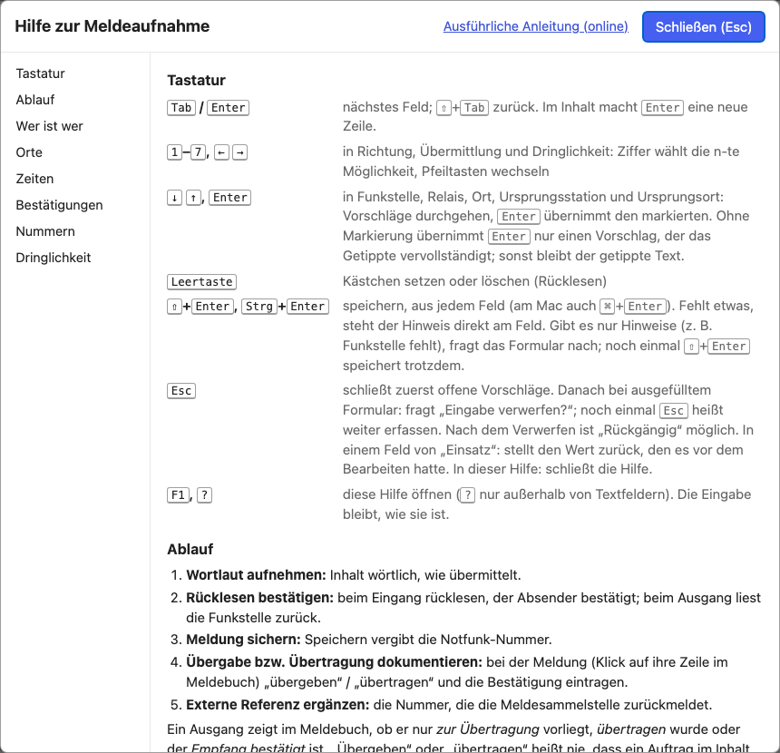

# Keyboard and help

[← Notfunk logbook (English)](../index.en.md) · [Open the Notfunk logbook](../../notfunk/index.html)
{ .doc-nav }

## Keyboard

| Key | Effect |
| --- | --- |
| <kbd>Tab</kbd> / <kbd>Enter</kbd> | next field (in the content: <kbd>Enter</kbd> = new line) |
| <kbd>⇧</kbd>+<kbd>Tab</kbd> | previous field |
| <kbd>1</kbd> – <kbd>7</kbd>, <kbd>←</kbd> <kbd>→</kbd> | choice for direction, transmission, urgency |
| <kbd>↓</kbd> <kbd>↑</kbd>, <kbd>Enter</kbd> | go through suggestions and accept one (radio station, relay, places, origin) |
| <kbd>Space</kbd> | tick the box (read back) |
| <kbd>⇧</kbd>+<kbd>Enter</kbd>, <kbd>Ctrl</kbd>+<kbd>Enter</kbd> | save |
| <kbd>Esc</kbd> | close suggestions, then "Eingabe verwerfen?" (discard the input?); once more = keep entering |
| <kbd>F1</kbd>, <kbd>?</kbd> | help (<kbd>?</kbd> only outside text fields); <kbd>Esc</kbd> closes it |

## Help in the tool

**"? Hilfe"** (far right in the header) or <kbd>F1</kbd> opens the short help
above the form. Your input stays as it is; after closing, the cursor is back
in the previous field.
